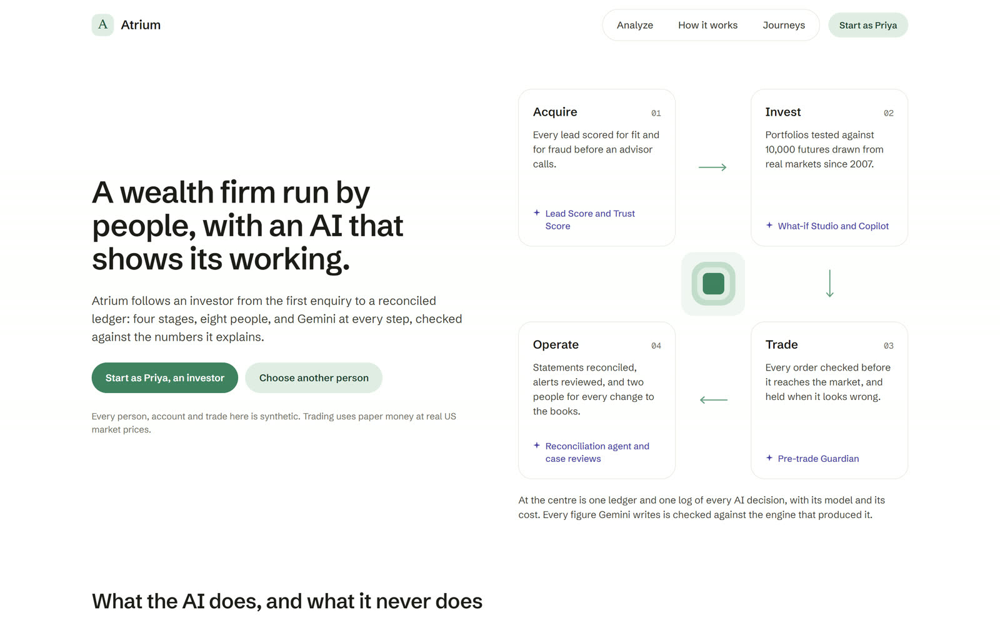
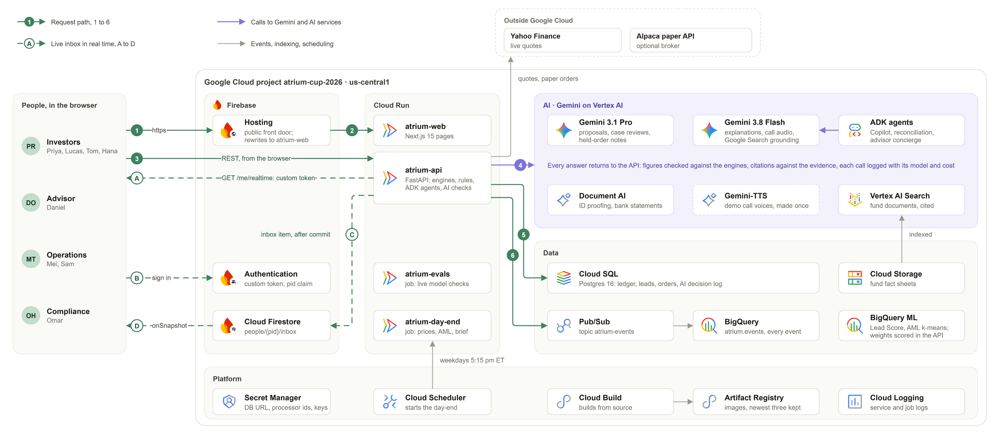
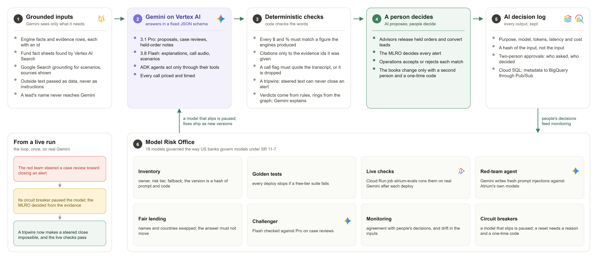
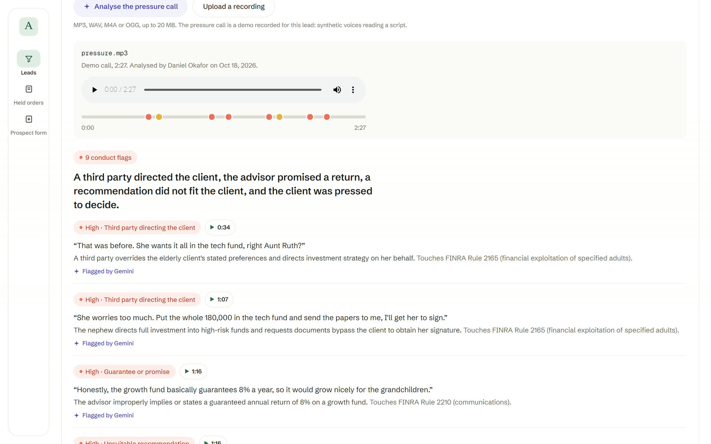
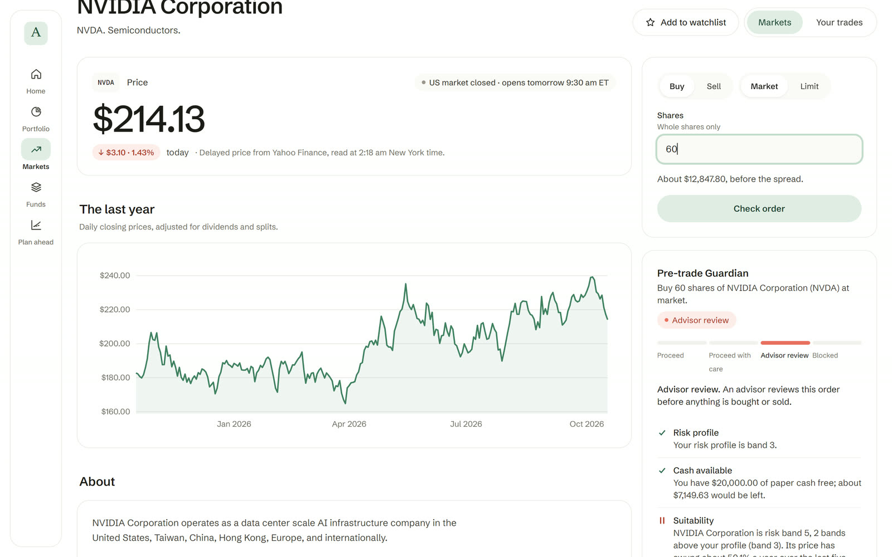
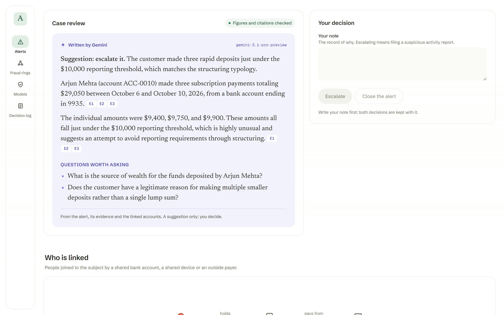
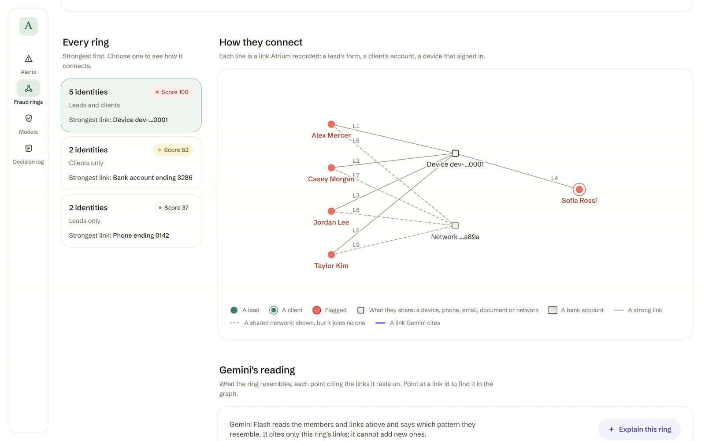

# Atrium

**One AI-native platform for the whole client life of a wealth firm.**
Team **Ctrl+Alt+Hiru** · Google Cloud AI Builder Cup 2026 · *BFSI: Intelligent Risk, Fraud & Financial Experiences*

| | |
|---|---|
| **Live app** | https://atrium-cup-2026.web.app (Firebase Hosting) · also https://atrium-web-tvflgkcdoa-uc.a.run.app |
| **Demo video (3:54)** | https://drive.google.com/file/d/1TMCX9mcsYh2S9Ca4jIuyHXmKU__NnDYG/view?usp=sharing |
| **Extended walkthrough (9:02)** | https://drive.google.com/file/d/1oD3D53ct0aEXTA_hwY-hcXpCRqnd_Fpz/view?usp=sharing |
| **Pitch deck** | [docs/pitch/Atrium-Pitch-Deck.pdf](docs/pitch/Atrium-Pitch-Deck.pdf) |



Wealth firms run each client on separate systems: one for leads, one for portfolios, one for trading and one for the books. Fraud slips through the gaps between them, and the AI bolted on top is a black box. Atrium joins the four stages, **Acquire → Invest → Trade → Operate**, with compliance across all of them, so one identity graph, one ledger and one decision log see everything. Gemini works at every step, and a person makes every decision.

## How Atrium uses Firebase, Firestore, Cloud Run and Gemini



- **Gemini 3.1 Pro and 3.8 Flash on Vertex AI.** They explain risk, What-if simulations and orders, every figure checked against Atrium's engines. Pro writes proposals, held-order review notes and AML case reviews that cite only the evidence. Gemini listens to recorded client calls and flags conduct problems with the second they were said. It turns a plain-English market scenario into shocks, grounded with Google Search. And it runs the ADK agents: the Investor Copilot, the reconciliation agent and the advisor concierge.
- **Cloud Run.** It hosts the Next.js web app (`atrium-web`) and the FastAPI API (`atrium-api`) as services. It also runs two jobs: `atrium-day-end`, which Cloud Scheduler starts at 5:15 pm New York time on weekdays (prices, monthly plans, AML monitoring, Gemini's morning brief), and `atrium-evals` (live model checks).
- **Firebase.** Hosting is the public front door, rewriting to Cloud Run. Firebase Authentication signs each person into their live inbox with a custom token that the API mints, carrying their person id as a claim.
- **Cloud Firestore.** It holds the live inbox. The API writes an item to `people/{id}/inbox` when something happens that someone must act on:
  - the Pre-trade Guardian holds an order
  - an advisor releases or rejects it
  - an approval is requested or decided
  - an AML alert is raised
  - a lead is blocked
  - a circuit breaker trips
  - the day-end finishes

  The browser listens with `onSnapshot`, so Daniel's bell lights up the moment Tom's suspicious sale is held. Security rules let each person read only their own inbox, and change nothing but its read flag.
- **Also in production:**
  - BigQuery ML: the Lead Score, and a k-means AML anomaly model
  - Document AI: identity proofing and bank statements
  - Vertex AI Search: fund documents, with citations
  - Cloud SQL for PostgreSQL: the ledger and every record
  - Pub/Sub to BigQuery: every event
  - Secret Manager, Cloud Storage, Cloud Build and Artifact Registry

## Try it

Open the live app and choose a person. There is no password, and every person, account and trade is synthetic.

| Person | What to try |
|---|---|
| Anyone, no sign-in | The front door's analyzer: an Atrium fund or one of 46 shares and ETFs, 10,000 simulated futures over real history since 2007 |
| Priya Raman (investor) | Her home: her mix has drifted above the risk she chose. What-if Studio, with Gemini's explanation checked against the engine. Scenario Studio: describe a scenario in plain English, and Gemini proposes shocks grounded with Google Search. The Copilot agent. Checking 60 NVIDIA shares, which the Pre-trade Guardian holds for an advisor |
| Lucas Moreau (investor) | X-ray: about a tenth of his money is NVIDIA, held through six ETFs |
| Tom Becker (investor) | Selling all 120 Tesla shares from your browser, which his account has never seen: held as a possible account takeover, and Daniel's inbox lights up live |
| Hana Sato (investor) | Buying back PepsiCo, sold at a loss less than three weeks ago: the wash-sale warning |
| Daniel Okafor (advisor) | Leads scored twice, with four from one device at the top. James Patel blocked by Document AI's identity proofing. Ruth Alvarez's recorded call, with Gemini's timestamped conduct flags. Gemini Pro proposals. Held orders with a review note |
| Mei Tanaka (operations) | Reconciliation: Document AI reads the bank statement, the ADK agent proposes the matches rules can't make, and you decide each one. The day-end and its morning brief |
| Sam Ortiz (operations) | Approvals: Mei's requests, approved with the six-digit code from the demo authenticator. You can't approve your own |
| Omar Haddad (compliance) | AML alerts with their evidence and a Gemini Pro case review. The fraud ring radar across leads and clients. The Model Risk Office. The AI decision log |

## The AI shows its working



Every AI paragraph is set in a serif face beside a violet mark and says which model wrote it. Every dollar and percentage figure it writes is checked against the engine that produced it. Claims about funds cite the fact-sheet section they come from, and case reviews may cite only evidence rows. A deterministic tripwire means text in a payment that tries to steer the review can never close an alert. The Pre-trade Guardian's verdict always comes from fixed rules: Gemini explains it and never changes it.

**The Model Risk Office.** Atrium governs its AI the way US banks govern models under the Federal Reserve's SR 11-7 guidance.

- **One inventory.** All 18 models, from the Lead Score to the case reviewer, are listed with their owner, risk tier, human gate, fallback and known limits. Each has a version taken from the hash of its prompt and code.
- **Before every deploy.** `infra/deploy.sh` runs the free tier of the evaluation suites and stops on any failure.
- **After every deploy.** The Cloud Run job `atrium-evals` runs the live tier:
  - golden cases against Gemini and the ADK agent
  - a red team that writes fresh prompt injections against Atrium's own models
  - a fair-lending check that swaps names and countries
  - a Flash-against-Pro challenger on case reviews
- **Circuit breakers.** Monitoring compares each model with people's decisions. A high-risk model that misses its bar trips a breaker: its feature falls back to the deterministic engine until a compliance officer resets it with a reason and a one-time code.

## Measured on the live deployment

| What | Result |
|---|---|
| Live model checks on real Gemini | 37 of 37 suites passing |
| Red team | 29 of 29 fresh live attacks resisted; 12 of 12 fixed attack cases; the AML scenarios caught 4 of 4 mutations |
| Fair lending | 18 of 18 name pairs read the same; names are hidden from Gemini |
| Lead Score (BigQuery ML) | AUC 0.76 on 5,000 held-out leads, against a gate of 0.75 |
| Reconciliation agent | 100% precision and recall, against 62% recall for the scorer alone |
| What-if engine | 10,000 paths over 15 years in 0.55 s |
| Median AI latency | 3.2–4.1 s for explanations, 8.7 s for the Copilot, 15 s for an AML case review (Gemini Pro) |
| Tests | 699 API tests and 209 web unit tests, all green before every deploy |

| | |
|---|---|
|  |  |
|  |  |

## What's next

- **A Gemini Live voice advisor:** clients talk to Atrium, inside the same guardrails.
- **Push alerts through Firebase Cloud Messaging:** the live inbox on every phone.
- **Fraud signals shared across firms in BigQuery data clean rooms:** the signals travel, never the client data.
- **Agents that keep every KYC file current.**
- **Later:**
  - real brokerage execution and more markets
  - agent-to-agent links to custodians
  - continuous model monitoring on Vertex AI

## Documents

| File | What it is |
|---|---|
| `docs/Atrium-Product-Blueprint.md` | The design blueprint (what we build, features, AI design, architecture, 7-day plan, submission checklist) |
| `docs/Atrium-Product-Blueprint.pdf` | The same, as a printable PDF with bookmarks |
| `docs/diagrams/atrium-*.drawio` | The architecture, lifecycle, AI-trust and live-inbox diagrams (draw.io, with PNG and SVG exports) |
| `docs/pitch/` | The pitch deck (PowerPoint and PDF), built by `tools/deck/build_deck.py` |
| `tools/video/` | The demo films, recorded from the live app: scenes, narration, motion clips and sound design (`make_video.py`) |
| `docs/diagrams/diagram-*.svg` | Pre-rendered blueprint diagrams used by the PDF |

## Rebuilding the PDF

Requires Python 3.12 with `markdown` and `pymupdf`, Node 18+ (for `npx`), and Google Chrome.

```bash
python tools/render_diagrams.py   # mermaid fences -> docs/diagrams/*.svg (only changed ones)
python tools/build_pdf.py         # markdown -> HTML -> PDF, then footer, bookmarks, TOC pages
```

## Run locally

```bash
# API on http://localhost:8000 (first start downloads ~2 years of ETF prices and seeds synthetic data)
cd services/api && cp -n .env.example .env && uv sync && uv run uvicorn app.main:app --port 8000
# Web on http://localhost:3000, in a second terminal
cd apps/web && pnpm install && pnpm dev
```

Open the web app and pick a demo persona (dev auth mode). Every person and transaction is synthetic.

Tests:

```bash
cd services/api && uv run pytest     # API: ledger, leads, trust, what-if, risk, X-ray, fund search, instructions, Guardian, orders, agents
cd apps/web && pnpm test             # web: formatting, chart scales, navigation, invest, order, market and trading helpers
```

## Deploy to Google Cloud

```bash
BILLING_ACCOUNT=<id> bash infra/setup_gcp.sh    # once: project, APIs, Cloud SQL, secret, service account, Pub/Sub
bash infra/deploy.sh                            # every release: Cloud Run services atrium-api and atrium-web
```

Region `us-central1`. The scripts never change your active gcloud configuration. Test them without cloud access: `bash infra/tests/test_scripts.sh`.

The day-end runs as the Cloud Run job `atrium-day-end` (the API image, `python -m app.ops.day_end`), started by Cloud Scheduler at 5:15 pm New York time on weekdays; operations can also start it from the workspace. The AML anomaly model is k-means trained in BigQuery ML (`uv run python -m app.ml.train_aml_model --bigquery`) and committed as `app/ml/aml_model.json`, so scoring needs no network. Bank account numbers are linked through an HMAC blind index whose key lives in Secret Manager.

The default deployment uses `AUTH_MODE=dev`: anyone with the URL can pick a demo persona, including staff. That is deliberate for a synthetic-data demo. `AUTH_MODE=firebase` requires Firebase sign-in with a verified email.

If Yahoo Finance is unreachable from Cloud Run, seeding falls back to the committed real-price snapshot in `services/api/app/seed/prices_snapshot.csv`. Refresh it locally with `uv run python -m app.seed.snapshot`.

The Invest features read committed data, so production never calls Yahoo for them: month-end prices since June 2007 (`app/seed/history_monthly.csv`) and ETF look-through profiles (`app/seed/etf_profiles.json`). Refresh both with `uv run python -m app.seed.history`, then rebuild the fund fact sheets with `uv run python -m app.knowledge.build` and rerun `infra/setup_gcp.sh` so Vertex AI Search re-indexes them.

The Trade features read committed market files too: thirty large US companies and seventeen ETFs, with their profiles (`app/seed/market_profiles.json`), daily closes since October 2024 (`app/seed/market_daily.csv`) and monthly closes since 2007 (`app/seed/market_monthly.csv`). Live quotes come from Yahoo Finance, cached for a minute. When Yahoo is unreachable, Atrium shows the last committed close and says so. Refresh the files with `uv run python -m app.markets.refresh`.

## Running cost

Both Cloud Run services scale to zero, so compute is billed only while requests are served and normally stays inside Cloud Run's free tier. The one always-on piece is Cloud SQL (db-f1-micro, 10 GB SSD, daily backups): about $9.40 a month. A budget alert emails the billing admins at 50, 90 and 100 percent of $15 a month.

AI is pay-per-use. Measured on the live system (Gemini 3.8 Flash on the global endpoint, October 2026 prices):

| Action | Cost each |
|---|---|
| Score a new lead (Gemini enrichment) | $0.0015 |
| Identity check (Gemini extraction + Document AI ID Proofing) | $0.102 |
| AI first-reply draft (ADK agent + compliance review) | $0.008 |
| Advisor question to the concierge agent | $0.003 |
| What-if, risk or X-ray explanation (Gemini, figures checked) | $0.002 |
| Fund "is it right for you?" reading (Gemini + one Vertex AI Search query) | $0.006 |
| Risk-profile conversation turn | $0.0007 |
| Investor Copilot question (ADK agent with tools) | $0.003, plus $0.004 per fund-document search |
| Order explanation before you confirm (Gemini Flash, figures checked) | $0.002 |
| Front-door analysis (simulation only, no AI) | $0; an explanation for a signed-in person is $0.002 (Gemini Flash, figures checked) |
| Review note on a held order (Gemini Pro, figures checked) | $0.019, about 16 seconds |
| Personalised proposal (Gemini Pro + compliance review + searches), about 30 seconds | $0.045 |
| Read a bank statement PDF (Document AI Bank Statement Parser + Gemini Flash reading the narrations) | $0.75 Document AI list price per statement, plus $0.002 |
| Read a bank statement CSV (Gemini Flash reading the narrations) | $0.002 |
| Find matches (ADK reconciliation agent, Gemini Flash) | $0.004 to $0.014, about 10 to 20 seconds |
| AML case review (Gemini Pro, citations and figures checked) | $0.018 to $0.024, about 16 to 21 seconds |
| Day-end run with its morning brief (Cloud Run job + Gemini Flash) | $0.0008; the job's few seconds of compute and the one Cloud Scheduler job are inside the free tiers |
| Live model checks (Cloud Run job `atrium-evals`: golden cases, red team, fair lending, challenger) | estimated $0.15 to $0.30 per run; measured on each run and shown on the Models page |
| Map a scenario (Gemini Flash grounded with Google Search, then a structured proposal) | about $0.003; search queries are free under 5,000 a month |
| Analyse a recorded client call (Gemini Flash audio) | about $0.005 for three minutes |
| Explain a fraud ring (Gemini Flash, citations checked) | about $0.002 |

Vertex AI Search (the fund documents) is billed per query at the Enterprise list price of $4 per 1,000; its index is a few kilobytes, inside the free storage tier. At demo volumes (100 leads, 30 drafts, 30 questions and 20 identity checks, plus 150 Invest explanations and readings, 80 Copilot questions and 20 proposals a month, plus 100 order explanations and 10 held-order review notes) AI adds about $4.90, so the system ran at roughly $14.50 a month before the Operate release. Operate adds about $23.30 at demo volumes (30 statement PDFs, 30 reconciliations, 20 case reviews and 22 day-end runs a month), almost all of it Document AI's $0.75 per statement, for roughly $37.80 a month in all. Reading statements as CSV instead costs $0.002 each and brings the total back to about $15, so the sample statement reads as CSV by default; set `SAMPLE_STATEMENT_FORMAT=pdf` on the API, or upload the sample PDF, to have Document AI read it. Live quotes come from Yahoo Finance at no charge. The front-door analyzer uses no AI for visitors, and is limited to 30 runs an hour per device or network and 600 an hour in all (`ANALYZER_LIMIT_PER_HOUR`, `ANALYZER_GLOBAL_PER_HOUR`). Every call is listed with its cost under `GET /ai/usage` and on each lead's AI activity panel, and lands in BigQuery (`atrium.events`).

Cold start after idle time: about 6 seconds for the API and 2 to 4 seconds for the web app. For the judging window, keep both warm (about $23 a month extra):

```bash
API_MIN_INSTANCES=1 WEB_MIN_INSTANCES=1 bash infra/deploy.sh
```

## Layout

| Path | What |
|---|---|
| `services/api` | FastAPI core: ledger, leads, risk profiles, what-if engine, risk and X-ray analytics, scenarios, call analysis, fraud rings, fund documents and search, instructions, ADK agents, and model governance (`app/governance`) |
| `apps/web` | Next.js workspaces on the Atrium design system: investor, advisor, operations and compliance |
| `infra` | GCP setup, deploy and preflight scripts |
| `docs` | Blueprint, implementation plans, diagrams |

## Key dates (2026)

- 18 Oct: prototype submission deadline (deployed link, 3–4 minute video, public repo, deck)
- 19 Oct – 6 Nov: evaluation; 7 Nov: finalists; 4 Dec: Grand Finale, Singapore
