# Atrium — Module Flows

One flowchart per module, drawn from the code on `dev` (October 2026) and checked against the blueprint and the six implementation plans. Every step names **who** does it. Where the code differs from the blueprint, the module's notes say so.

## How to read the charts

Each box starts with its actor in bold. Colour shows the kind of actor:

| Colour | Actor kind | Actors |
|---|---|---|
| Blue | Person | Visitor, Prospect, Investor, Advisor (Daniel), Operations (Mei), Second approver (Sam), MLRO (Omar) |
| Grey | Web app | Next.js workspace in the browser |
| Green | Atrium engine | Core API, rule engines (Trust, Guardian, AML, reconciliation rules), ledger, day-end job |
| Amber | AI | Gemini Flash, Gemini Pro, ADK agents |
| Purple | Outside service | Document AI, Vertex AI Search, Firebase, broker (paper or Alpaca), Yahoo Finance, Cloud Scheduler |
| Red | Stop | The request is refused, with the reason shown |

A rule that runs everywhere: **AI explains and proposes; engines and rules count and decide; a person makes every fact-changing decision.** Every AI call is written to the AI decision log (module 14).

## Modules

| # | Pillar | Module | Main actors |
|---|---|---|---|
| 0 | Platform | Front door, sign-in and workspace | Visitor, Web, Firebase, Core API |
| 1 | Acquire | Lead capture and scoring | Prospect, Core API, Gemini Flash, Trust rules, Advisor |
| 2 | Acquire | Identity document check | Advisor, Gemini Flash, Document AI, Trust rules |
| 3 | Acquire | Working a lead: concierge, reply draft, proposal | Advisor, ADK agents, Gemini Pro, Vertex AI Search |
| 4 | Acquire | Convert to client | Advisor, Core API |
| 5 | Invest | Risk profile conversation | Investor, Gemini Flash, Risk-profile rules |
| 6 | Invest | Insights: What-if, X-ray, Risk, fund reading | Investor, analytics engines, Gemini Flash, Vertex AI Search |
| 7 | Invest | Fund orders (instructions) and monthly plans | Investor, Core API, day-end job |
| 8 | Invest | Investor Copilot | Investor, Investor Copilot agent |
| 9 | Trade | Placing an order through the Pre-trade Guardian | Investor, Guardian rules, Gemini Flash, broker |
| 10 | Trade | Held-order review | Advisor, Gemini Pro, Guardian rules, broker |
| 11 | Operate | Day-end run | Cloud Scheduler or Operations, day-end job, Gemini Flash |
| 12 | Operate | Bank statement intake and reconciliation | Operations, Document AI, Gemini Flash, reconciliation agent |
| 13 | Operate | Four-eyes approvals (prices, manual match, reversal) | Operations, second approver, Core API, ledger |
| 14 | Operate | AML monitoring and case decision | Day-end job, AML rules, k-means model, Gemini Pro, MLRO |
| 15 | Platform | AI decision log and event stream | Every AI call, Core API, Pub/Sub, BigQuery |

---

## 0. Front door, sign-in and workspace

Code: `apps/web/src/app/page.tsx`, `apps/web/src/lib/nav.ts`, `apps/web/src/lib/journeys.ts`, `services/api/app/auth.py`, `routers/me.py`.

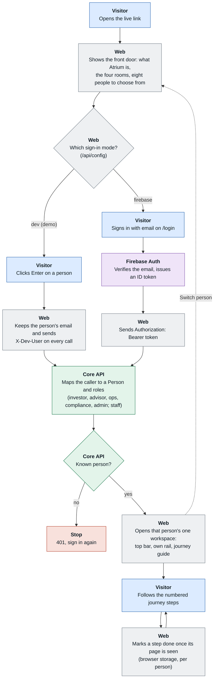

**Notes**
- Role to workspace: investor → Investor, advisor and admin → Advisor, ops → Operations, compliance → Compliance. Each person sees only their own workspace.
- `/apply` (the prospect form) and `/login` are public; everything else needs a person.
- The demo deploys with `AUTH_MODE=dev` on purpose: anyone with the link can pick any persona, staff included.
- **Docs vs code:** the blueprint lists an Admin workspace (P1). There is no separate one; admin is routed to the Advisor workspace and may also decide compliance alerts.

---

## 1. Lead capture and scoring

Code: `routers/leads.py` (`POST /leads`, `POST /leads/score-pending`), `services/lead_pipeline.py`, `services/enrichment.py`, `ml/lead_model.py`, `services/trust.py`, `services/capture_guard.py`.

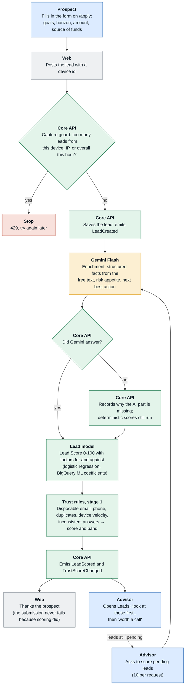

**Trust bands:** 80 and above `clear`; 50 to 79 `review`; below 50 `high_risk`; a blocking signal makes it `blocked`. A rising score adds friction; only a person blocks or converts.

**Docs vs code**
- Blueprint §8.3 shows scoring as asynchronous agents fed by Pub/Sub. The code scores **inline** in the capture request, with `score-pending` as the catch-up path. Pub/Sub only carries the events outward.
- Blueprint A3/A4 name BigQuery ML for both the Lead Score and lead anomaly detection. The Lead Score uses committed model coefficients (`lead_model.json`); stage-1 Trust is fixed rule weights plus Gemini's enrichment, with no anomaly model at the lead stage.
- A6 sanctions and PEP screening is not built (P1 in the blueprint).

---

## 2. Identity document check

Code: `POST /leads/{id}/documents`, `services/identity.py`, `services/trust.py`.

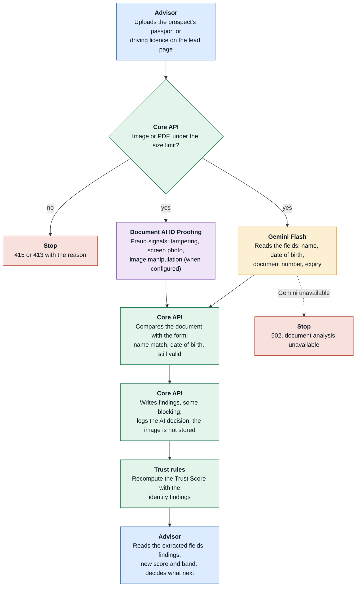

**Docs vs code:** the blueprint sequence has the **prospect** uploading the ID with the form. In the code the upload is a **staff-only** step on the lead page; the public form takes no documents.

---

## 3. Working a lead: concierge, reply draft, proposal

Code: `POST /leads/{id}/ask`, `/draft-reply`, `/proposal`, `PATCH /leads/{id}/stage`; `agents/advisor.py`, `services/compliance.py`, `services/proposal.py`.

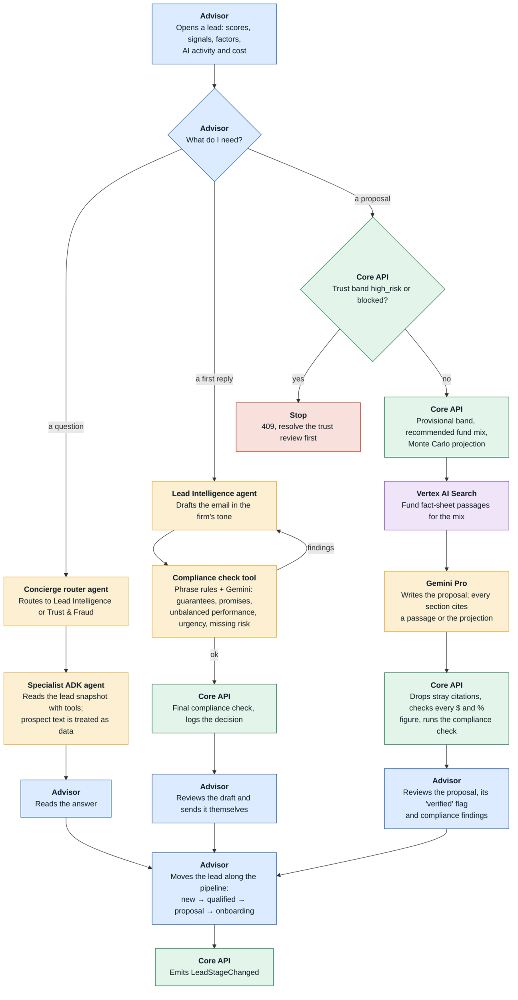

**Docs vs code**
- Atrium does not send the email; the advisor sends the reviewed draft from their own mail.
- A9 meeting brief and A11 call summary are not built (P1 and P2).

---

## 4. Convert to client

Code: `POST /leads/{id}/convert`, `services/conversion.py`.

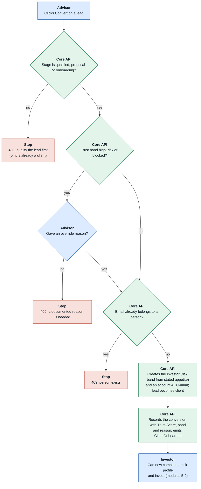

**Notes:** the account's trading Trust Score (module 9) starts from the score the lead earned here. The override reason stays in Cloud SQL; the event only flags that one was recorded.

---

## 5. Risk profile conversation

Code: `routers/profile.py` (`GET/POST /me/risk-profile`, `POST /me/risk-profile/chat`), `services/risk_profile.py`.

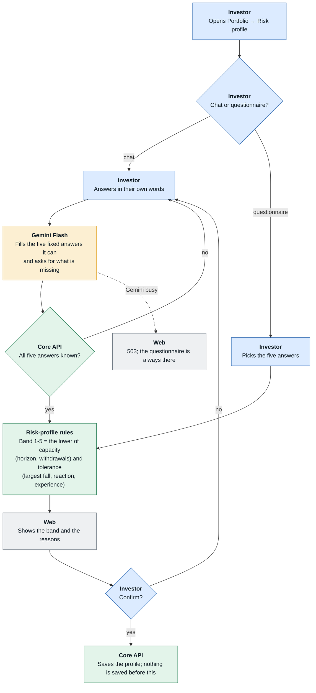

Gemini only collects answers; it never sets the band.

---

## 6. Insights: What-if, X-ray, Risk and fund reading

Code: `routers/invest.py`, `routers/insights.py`, `routers/funds.py`, `services/whatif.py`, `services/xray.py`, `services/risk_metrics.py`, `services/narrative.py`, `knowledge/fit.py`.

All four share one pattern: an engine computes, then Gemini may explain, and its figures are checked against the engine.

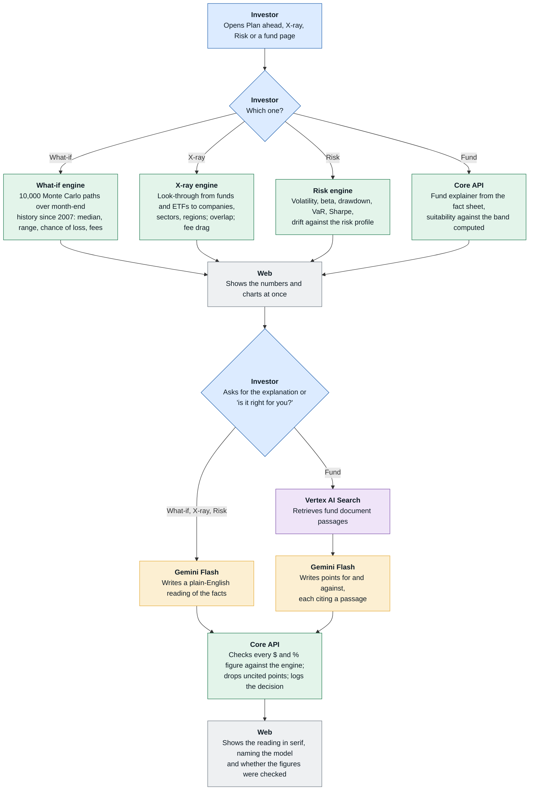

**Docs vs code:** B5 stress tests, B9 proactive insights, B10 news digest and B12 statements and tax reports are not built (P1).

---

## 7. Fund orders (instructions) and monthly plans

Code: `routers/instructions.py`, `services/instructions.py`, `services/allocation.py`. Instruction states: `received → checked → accepted → priced → allocated → settled` (or `rejected`, `reversed`).

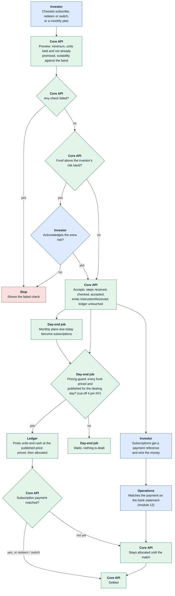

**Docs vs code:** B11 in the blueprint says instructions are pre-checked "by the Trust and Trade agents". In the code the pre-check is deterministic rules (minimum, holdings, suitability); no agent and no Trust Score is involved for fund orders.

---

## 8. Investor Copilot

Code: `POST /accounts/{id}/copilot`, `agents/investor.py`.

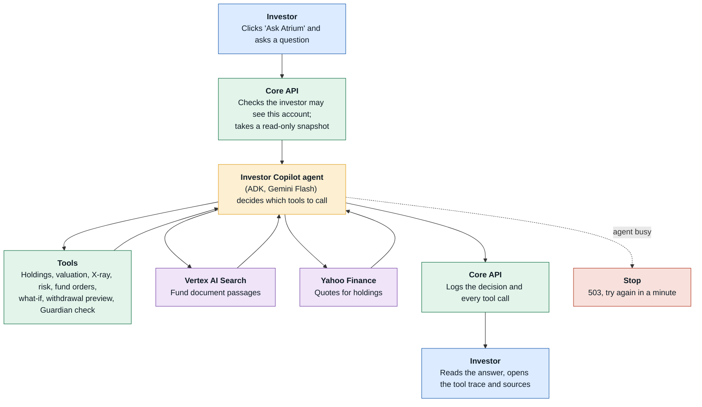

Nothing inside the agent loop writes to the database; the copilot answers but never places an order.

---

## 9. Placing an order through the Pre-trade Guardian

Code: `routers/trading.py` (`/orders/preview`, `/orders/explain`, `/orders`, `/cancel`), `services/orders.py`, `services/guardian.py`, `services/account_trust.py`, `markets/broker.py`, `services/order_ai.py`.

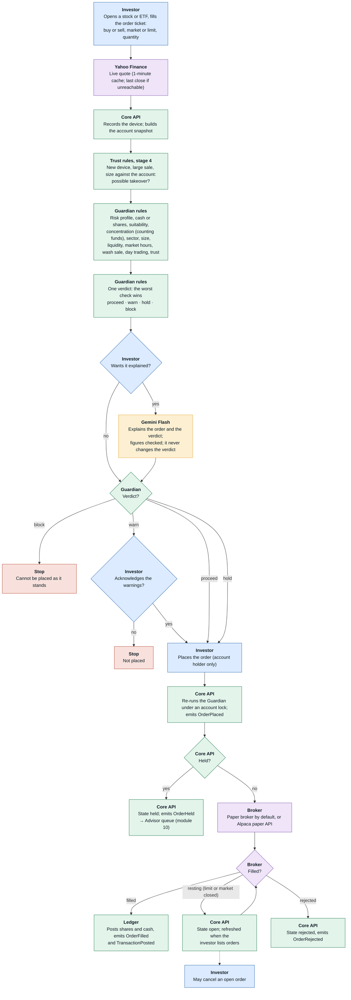

**Thresholds:** one company above 15% of the account warns, above 35% holds; a sector above 40% warns; an order above 25% of the account warns; above 1% of daily volume warns.

**Docs vs code**
- Blueprint C3 and §6.2 describe the Guardian as an **ADK agent** with Gemini reasoning. The code makes it **fixed rules only**, so the same order always gets the same verdict; Gemini explains (C4) and, for held orders, writes a review note (module 10).
- Blueprint C2 routes orders to Alpaca. The default is Atrium's own paper broker; Alpaca is used when its keys are set.
- C5 post-trade anomaly detection, C6 holding intelligence and C7 rebalancing are not built (P1).

---

## 10. Held-order review

Code: `GET /orders/held`, `POST /orders/{id}/review-note`, `/release`, `/reject`.

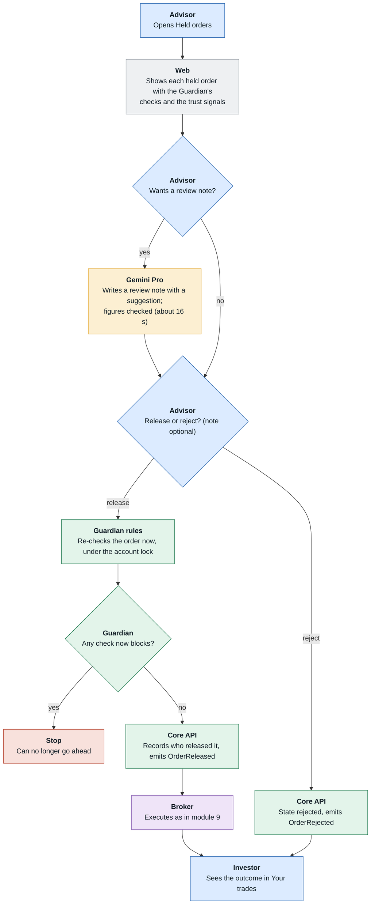

The release is the advisor's decision; the review note only suggests.

---

## 11. Day-end run

Code: `ops/day_end.py` (Cloud Run job `atrium-day-end`), `POST /operations/day-end`, `services/fund_pricing.py`, `services/allocation.py`, `services/aml.py`.

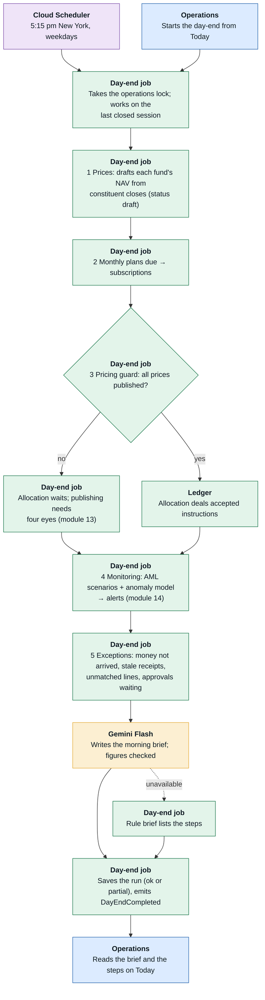

Each step records what it did; a failing step is recorded and the others still run. Because prices are only drafted here, allocation normally deals on the **next** run, after a second person has published them.

**Docs vs code:** blueprint §8.3 has the Compliance agent triage every alert during the day-end. In the code alerts are only raised here; the Gemini Pro review runs when the MLRO asks for it (module 14). The morning brief is for operations; the advisor pipeline brief (P8) is not built.

---

## 12. Bank statement intake and reconciliation

Code: `routers/operations.py` (`/statements`, `/statements/sample`, `/reconcile`, `/matches/*`), `services/statements.py`, `services/reconciliation.py`, `agents/reconciler.py`.

```mermaid
flowchart TD
    A["<b>Operations</b><br/>Opens Reconciliation"]:::person --> B{"<b>Operations</b><br/>Read the sample or upload a statement?"}:::person
    B -- "sample" --> C["<b>Core API</b><br/>Writes a sample statement for the payments<br/>Atrium is waiting for (CSV by default)"]:::system
    B -- "upload" --> D{"<b>Core API</b><br/>PDF or CSV, up to 10 MB?"}:::system
    D -- "no" --> X["<b>Stop</b><br/>413 or unsupported"]:::stop
    C --> E{"<b>Core API</b><br/>Format?"}:::system
    D -- "yes" --> E
    E -- "PDF" --> F["<b>Document AI</b><br/>Bank Statement Parser extracts the lines"]:::ext
    E -- "CSV" --> G["<b>Core API</b><br/>Parses the CSV"]:::system
    F --> H["<b>Gemini Flash</b><br/>Reads each narration: payer, quoted reference<br/>(typos kept), how the money came"]:::ai
    G --> H
    H -. "unavailable" .-> H2["<b>Core API</b><br/>Rule reading"]:::system
    H --> I["<b>Operations</b><br/>Checks counts and the balance; clicks Find matches"]:::person
    H2 --> I
    I --> J["<b>Reconciliation rules</b><br/>Exact reference + amount (0.99);<br/>unique amount from the holder (0.85)"]:::system
    J --> K["<b>Reconciliation agent</b><br/>(ADK, Gemini Flash) works what is left with scoring<br/>tools: fuzzy references, split payments"]:::ai
    K -. "agent fails" .-> K2["<b>Scorer</b><br/>Proposes the strongest candidates itself"]:::system
    K --> L["<b>Core API</b><br/>Proposals with tier, confidence and evidence;<br/>emits MatchProposed"]:::system
    K2 --> L
    L --> M{"<b>Operations</b><br/>Accept or reject each proposal<br/>('accept all exact matches')"}:::person
    M -- "accept" --> N["<b>Core API</b><br/>Funds the subscription: settled now if<br/>already allocated, else at allocation"]:::system
    M -- "reject" --> O["<b>Core API</b><br/>Lines return to unmatched, with the note"]:::system
    O --> P{"<b>Operations</b><br/>Match by hand?"}:::person
    P -- "yes" --> Q["<b>Operations</b><br/>Requests a manual match with a reason<br/>→ four eyes (module 13)"]:::person

    classDef person fill:#DCEBFF,stroke:#1F5FAD,color:#0F1B24
    classDef web fill:#EEF0F2,stroke:#6B7680,color:#0F1B24
    classDef system fill:#E3F4EA,stroke:#157347,color:#0F1B24
    classDef ai fill:#FCEFD2,stroke:#E3A72F,color:#0F1B24
    classDef ext fill:#EFE4F8,stroke:#7A4BA8,color:#0F1B24
    classDef stop fill:#F8E1DC,stroke:#B23A26,color:#0F1B24
```

The agent's tools check every id and amount, so it cannot use a line twice, claim a subscription that is not open, or propose a combination that does not add up. In the demo, operations can also add another set of waiting payments so each visitor has something to reconcile.

---

## 13. Four-eyes approvals

Code: `services/approvals.py`, `services/fund_pricing.py` (`request_publish`, `execute_publish`), `services/reconciliation.py` (manual match), `services/reversals.py`, `routers/me.py` (`/me/authenticator`).

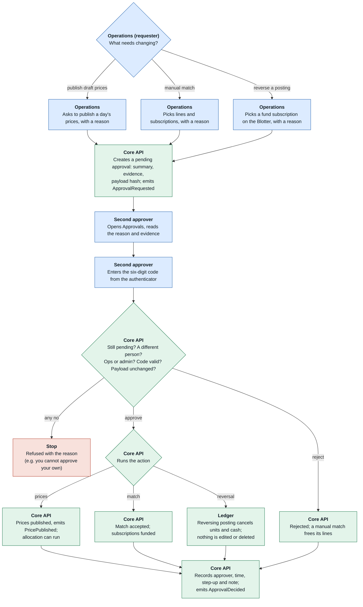

**Docs vs code:** blueprint D6 also lists **bank-detail change** and **large redemption** as four-eyes actions. The code supports three: `publish_prices`, `manual_match`, `reverse_posting`. A reversal is allowed only for a fund subscription whose units are all still held.

---

## 14. AML monitoring and case decision

Code: `services/aml.py`, `ml/aml_model.py`, `services/compliance_ai.py`, `routers/compliance.py`.

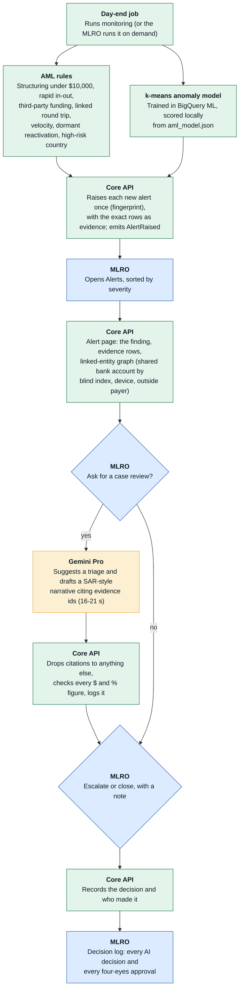

**Docs vs code**
- Blueprint D7 runs the scenarios as SQL over BigQuery. The code runs them in Python over Cloud SQL; BigQuery is used to train the anomaly model and to receive events.
- Blueprint D8 and §6.2 call the Compliance copilot an ADK agent. The code makes one Gemini Pro call with the evidence; it has no tools.
- Bank-detail change followed by withdrawal (named in D7) is not among the scenarios. D9 KYC refresh and D12 report pack are not built.

---

## 15. AI decision log and event stream

Code: `ai/decisions.py`, `events.py`, `routers/ai.py` (`GET /ai/usage`), `GET /leads/{id}/decisions`, `GET /compliance/ai-decisions`.

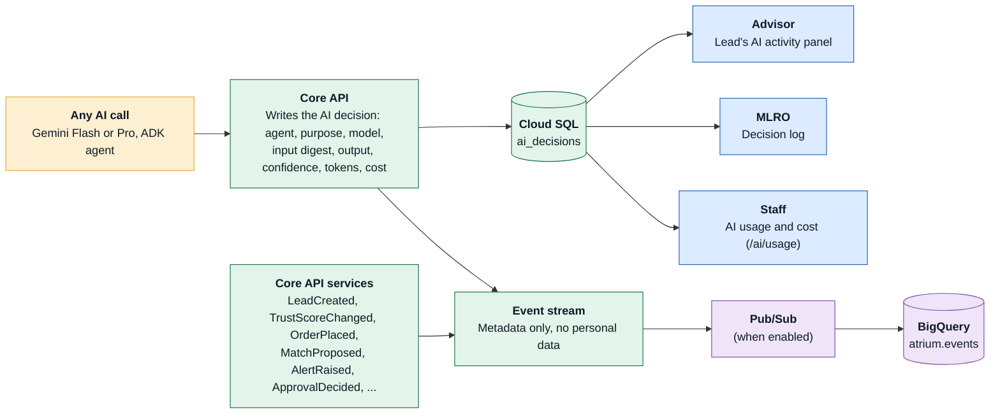

**Docs vs code:** blueprint D11 records the approver of each AI output. The AI log does not; approvals are in their own table and log. P3 (Cloud DLP redaction before text reaches a model) and P6 (evaluation harness) are not built.

---

## Summary: where the code differs from the blueprint

| Area | Blueprint says | Code does | Module |
|---|---|---|---|
| Lead scoring timing | Async agents fed by Pub/Sub | Inline in the capture request, plus a staff catch-up | 1 |
| Lead anomaly detection | BigQuery ML at the lead stage | Rule weights plus Gemini enrichment | 1 |
| Sanctions and PEP (A6) | P1 feature | Not built | 1 |
| ID upload | Prospect uploads with the form | Advisor uploads on the lead page | 2 |
| Fund-order pre-check (B11) | Trust and Trade agents | Deterministic rules | 7 |
| Pre-trade Guardian (C3) | ADK agent with Gemini reasoning | Fixed rules; Gemini only explains and writes review notes | 9, 10 |
| Broker (C2) | Alpaca paper | Own paper broker by default, Alpaca when keys are set | 9 |
| Concierge router | Routes across all seven agents | Routes between the two advisor agents only | 3 |
| Day-end triage | Compliance agent triages every alert | Alerts raised; Gemini Pro review on the MLRO's request | 11, 14 |
| AML scenarios (D7) | SQL over BigQuery | Python over Cloud SQL; BigQuery trains the model | 14 |
| Compliance copilot (D8) | ADK agent | Single Gemini Pro call, no tools | 14 |
| Four-eyes actions (D6) | Prices, manual match, bank-detail change, large redemption | Prices, manual match, ledger reversal | 13 |
| Admin workspace (P1) | Separate workspace | Admin uses the Advisor workspace | 0 |

Most of these are deliberate: the Guardian and the Trust Score were made rule-based so the same input always gives the same verdict, which the blueprint's own principle ("AI never changes a fact; it proposes") favours. They are listed so the deck and the video describe what the product actually does.
