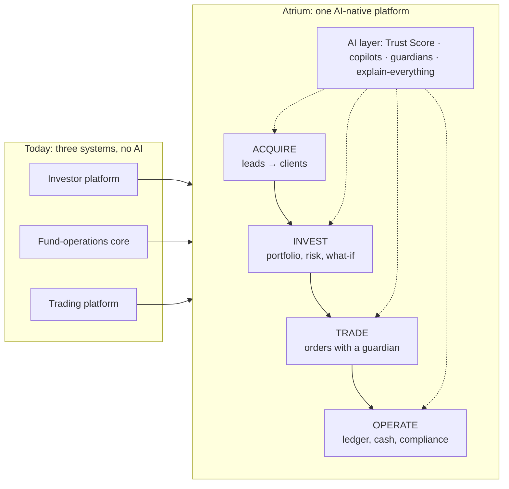
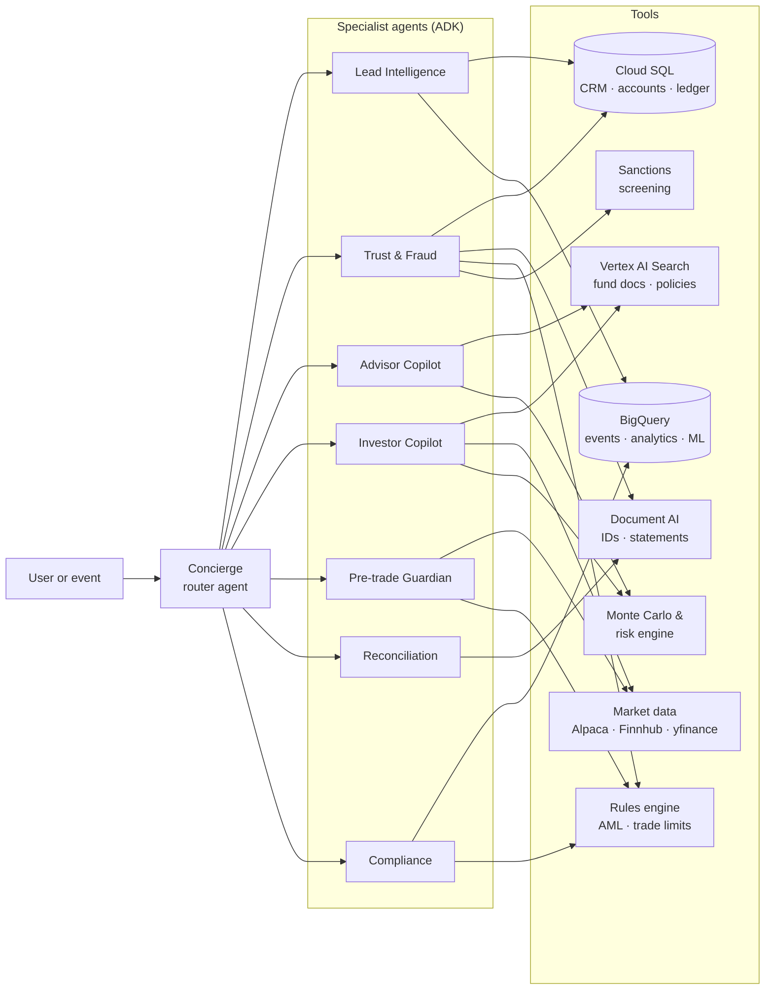
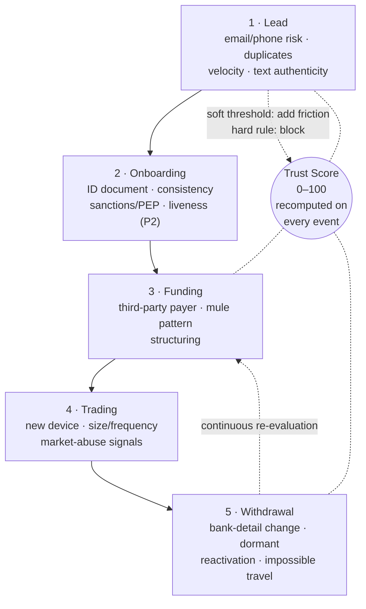
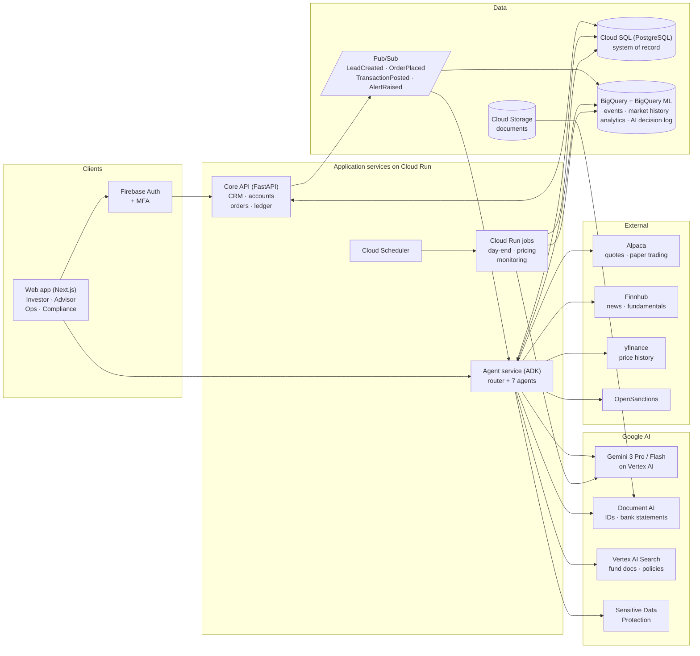
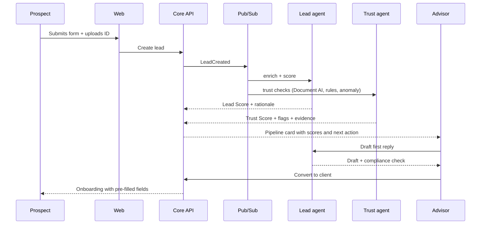
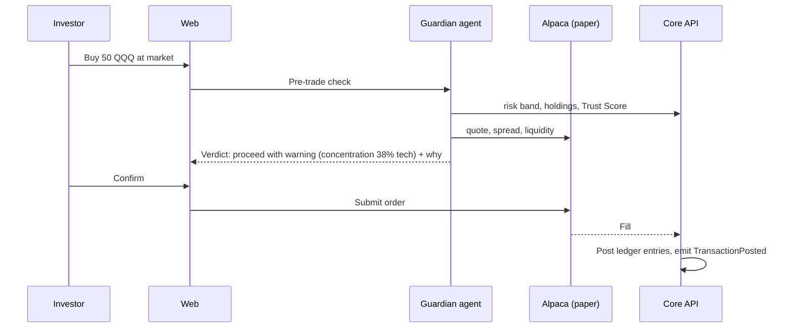

# Atrium — Product Blueprint

**AI-native wealth operating system: from first lead to settled trade**

| | |
|---|---|
| **Event** | Google Cloud AI Builder Cup 2026 (JAPAC) |
| **Theme** | BFSI: Intelligent Risk, Fraud & Financial Experiences |
| **Team** | Ctrl+Alt+Hiru |
| **Version** | 0.1 — design draft for team review |
| **Date** | 11 October 2026 |
| **Status** | Awaiting team sign-off before build starts |

> **How to read this document.** Section 1 is the one-page pitch. Sections 2 and 3 explain the challenge and the three platforms we are synthesising. Sections 4 to 7 are the product: personas, feature catalogue, AI design and what makes it novel. Sections 8 to 10 are the engineering: architecture, data, build plan. Section 11 is the submission checklist. Section 13 lists the decisions the team must make today.

---

## 1. Executive summary

**What we are building.** Atrium is a single AI-native platform for a wealth and investment firm operating in US and global markets. It joins three things that today live in three separate systems: the **front office** that turns leads into clients, the **investor experience** where clients hold, understand and trade their portfolios, and the **operations and compliance core** that keeps the books, reconciles cash and watches for fraud and money laundering. Generative AI is not a chatbot bolted on the side. It is the layer that scores, explains, drafts, reconciles and guards at every step.

**Why this wins the BFSI theme.** The theme asks for fraud and risk detection, automation of complex processes, better customer interactions and more personalised, informed financial experiences. Atrium hits all four in one coherent journey, and it does so with a feature set that a judge can follow in three minutes: a lead arrives and is scored and fraud-checked, becomes an investor who sees a personalised proposal and a what-if simulation, places a trade that an AI guardian checks first, and the money is reconciled and monitored by agents that explain every decision to a human approver.

**Five ideas that make it novel.**

1. **Lifecycle Trust Score.** One continuously re-evaluated identity and fraud score that follows a person from the first web form through onboarding, trading and withdrawals. Fraud detection starts at the lead, not at account opening.
2. **What-if Studio.** Monte Carlo projections over our real fund histories, narrated by Gemini, that answer "what happens if I invest this amount for this long, and why this fund for me".
3. **Pre-trade Guardian.** An agent that checks every order against the investor's risk profile, concentration, liquidity and behavioural anomalies before it goes to market, and explains its verdict.
4. **Agentic reconciliation and compliance copilot.** Document AI reads bank statements, an agent proposes matches with confidence, AML scenarios raise alerts, and Gemini drafts the case narrative. A human approves every fact-changing action.
5. **Explain-everything.** Every AI score, recommendation or draft carries a "Why" panel with cited evidence and a confidence level, and every AI decision is logged to BigQuery for audit.

**Stack.** Gemini 3 on Vertex AI, Agent Development Kit (ADK) multi-agent system, BigQuery and BigQuery ML, Document AI, Vertex AI Search, Cloud SQL for PostgreSQL, Pub/Sub, Cloud Run, Firebase Authentication. Market data and paper trading from Alpaca, with Finnhub and yfinance as secondary sources.

**Constraints that shape everything.** Prototype submission closes **18 October 2026**, seven days from today. The project must be fresh (no code reuse from existing work), built on Google Cloud, deployed on Cloud Run or Firebase, with a public GitHub repo, a PDF deck and a demo video under three minutes.

---

## 2. The challenge, decoded

### 2.1 What the organisers ask for

The BFSI problem statement (from the official themes page) reads: *"Build an AI-powered solution that addresses meaningful challenges across banking, financial services, insurance, or related industries. Solutions may focus on detecting and mitigating fraud or risk, automating complex processes, improving customer interactions, or delivering more personalized and informed financial experiences."*

Suggested solution directions: fraud detection, transaction anomaly analysis, document intelligence, financial assistance, personalised recommendations, compliance automation, risk assessment.

Suggested Google Cloud technologies: Gemini on Vertex AI for reasoning and conversational experiences, BigQuery for transaction and risk analytics, Vertex AI for predictive or classification models, Document AI for financial and non-traditional documents, Vertex AI Search / Agent Search for policy and knowledge retrieval, Cloud Run for application services, Cloud SQL or AlloyDB for application data, Pub/Sub for event-driven transaction processing.

Atrium uses every one of those products for a real job, not as decoration. Section 8 maps each to a feature.

### 2.2 Judging criteria and how we target them

| Criterion | Weight | What judges look for (official wording, condensed) | How Atrium scores |
|---|---|---|---|
| Technical Merit & Gen AI Implementation | **40%** | Meaningful Gen AI that directly solves the problem; functional, sound implementation; scalability beyond the prototype | Multi-agent ADK system with Gemini for reasoning, RAG and multimodal document work; BigQuery ML for anomaly and propensity models; event-driven Cloud Run services; every AI call grounded, logged and explainable |
| Problem Alignment & Impact | **25%** | Addresses the theme and challenge objective; clear value for intended users | Covers all four theme bullets in one journey; three real user groups (prospects/investors, advisors, operations/compliance), each with measurable wins |
| Innovation & Creativity | **25%** | Originality, differentiation, creative Gen AI beyond superficial use | Lifecycle Trust Score, What-if Studio, Pre-trade Guardian, agentic reconciliation, explain-everything (Section 7) |
| User Experience & Solution Design | **10%** | Usable, accessible, cohesive integration of components including Gen AI | One product, three role-based workspaces, consistent "Why" panels, mobile-responsive, demo-ready flows |

Special awards worth targeting on top of the main ranking: **Best use of Google Cloud AI tools** (USD 2,000), **Best UI/UX** (USD 2,000), **Most Impactful Solution** (USD 2,000). The main prizes are USD 10,000 / 7,000 / 5,000.

### 2.3 Timeline and hard rules

| Date (2026) | Milestone |
|---|---|
| 11 Oct | Registration and team formation closes (today) |
| **18 Oct** | **Prototype submission deadline** |
| 19 Oct – 6 Nov | Evaluation phase |
| 7 Nov | Finalists announced |
| 4 Dec | Grand Finale, Singapore (in-person demo day; two members travel, sponsored) |

Rules from the official FAQ that constrain our build:

- **Fresh project only.** Work started before the programme is not eligible. We write every line of Atrium from scratch during the hackathon window. Ideas and domain knowledge are ours; employer or client code is not to be copied. This is also an intellectual-property and confidentiality obligation, not only a contest rule.
- **Google Cloud stack.** Solutions built primarily on another cloud are ineligible. Deploy on Cloud Run, GCP or Firebase.
- **One theme, one submission per team.** We submit under BFSI only.
- **Team of 2 to 4**, all working professionals aged 21+, based in JAPAC. Students disqualify the whole team.
- **Deliverables:** working deployed link, demo video under 3 minutes (public YouTube, Vimeo or Drive), public GitHub repository, and a deck submitted as PDF covering vision, problem and community benefit, feasibility and scalability. Everything in English.

---

## 3. What we are synthesising: three platforms, one product

Our inspiration is the real estate of a wealth management firm: an investor platform, a fund-operations core, and a broker trading platform. Each is a serious system in its own right. None of them is AI-native, and they do not talk to each other well. Atrium takes the best job each one does and rebuilds it as one AI-first product for US and global markets.

### 3.1 The investor platform (client-facing web and mobile)

**What it does today.** Client onboarding with KYC capture (occupation, income range, source of funds, source of wealth, politically-exposed-person flag, beneficial owners for corporate clients). Instruction workflows for subscriptions, redemptions, switches and transfers, each with approval steps and signatures. Recurring investment plans. Portfolio holdings and valuations. Analytics: daily and period returns, a key-metrics dashboard, security allocation. Account statements with configurable periods. Tax reports using FIFO lot accounting. Publications, notices and reports. Secure messaging with attachments and real-time notifications. Product classifications (asset management, wealth management) that drive which workflows a client sees.

**Where it falls short.** Everything is a form and a table. Nothing explains itself. The client cannot ask "why did my portfolio fall this month" or "what would happen if I added USD 500 a month". There is no lead or prospect stage at all; the platform starts at account opening. Risk is a questionnaire, not a living profile.

### 3.2 The fund-operations core (back office)

**What it does today.** An append-only unit register with FIFO lots, so every holding can be rebuilt from its history. Order intake with dealing-date rules and a pricing guard that blocks every approval while any fund lacks today's price. NAV and unit-price calculation from fund valuations and units in issue, with checker and trustee approval. Bank statement intake and cash matching in tiers: exact reference match, unique amount match, fuzzy suggestions, and combinations, with a second person approving every manual match. Four-eyes approvals with a one-time code per high-risk action. Fee management. Transaction monitoring built from 25 scenarios and about 60 red-flag indicators, with holder linkage over blind indexes, alert evidence that points at the exact register rows, and case escalation to the money-laundering reporting officer. Day-end feeds to analytics. Immutable audit archive.

**Where it falls short.** Matching, monitoring and approvals are rule-driven and manual. Operators read statements by eye, investigate alerts by hand, and write case narratives from scratch. Documents (statements, identity proofs) are uploaded, not understood.

### 3.3 The broker trading platform

**What it does today.** Online equity trading across web, desktop and mobile: order placement, portfolio tracking, watchlists, real-time market data, research, margin trading, and the middle-office and back-office functions behind them (risk management, settlement, direct market access through institutional APIs). A staff-side wealth blueprint hands unit-trust instructions to the investor platform through an idempotent, correlation-id based contract.

**Where it falls short.** It is execution without judgement. Nothing checks whether a trade suits the person placing it, flags a behavioural anomaly, or explains the market context of a holding.

### 3.4 The synthesis



The journey the judges will see is left to right: **Acquire → Invest → Trade → Operate**, with the AI layer running under all four.

---

## 4. Product definition

### 4.1 Name

**Atrium.** An atrium is the central, light-filled core of a building where every corridor meets. It is where a visitor enters (leads), where residents live (investors), and the structural core that everything hangs from (operations). Light comes in from above, which is the point of our explain-everything principle: nothing in the building is hidden. The name also quietly carries the trading heritage in its first letters and the "core" idea in its meaning, without naming any existing product.

Alternatives, if the team prefers a different emphasis:

| Candidate | Emphasis | Trade-off |
|---|---|---|
| **Keel** | Stability and risk ("keeps every portfolio on course") | Strong for the risk theme, weaker for the full-platform story |
| **Trident** | Three pillars in one | Memorable but widely used |
| **Coreline** | The one line of truth from lead to settlement | Descriptive, less evocative |

Action before the deck: a quick trademark and domain check on the chosen name.

### 4.2 Positioning statement

*For wealth and investment firms serving retail and affluent clients in US and global markets, Atrium is the AI-native operating system that acquires, serves, protects and administers every client relationship in one place, so that firms grow faster with less fraud, less manual work and investors who understand what they own.*

### 4.3 Market scope

- **Instruments:** US-listed equities and ETFs, plus a set of "house funds" (Section 5.3) built as model portfolios of ETFs. Global exposure comes through global and international ETFs. Mutual funds are represented through their ETF equivalents because free, reliable mutual-fund data is scarce.
- **Currency:** USD base currency, with display conversion as a stretch goal.
- **Market data:** Alpaca (real-time US equities, no daily cap on the free tier, and a paper-trading API we can place orders against), Finnhub (quotes, news, fundamentals; free tier about 60 calls per minute with delayed quotes), yfinance (long price history for the what-if engine). Alpha Vantage is too limited (25 requests per day) for anything beyond a fallback.
- **Trading:** paper trading only. No real money moves anywhere in the prototype.

### 4.4 Personas

| Persona | Who they are | What they need | What Atrium gives them |
|---|---|---|---|
| **Priya, the prospect / investor** | 34, software manager, USD 60k to invest, has heard of the firm from a friend | To understand whether this firm and its funds are right for her, what her money could become, and to invest and trade without feeling lost | Personalised proposal, What-if Studio, portfolio copilot, risk analytics in plain language, a trade guardian, statements and tax reports that explain themselves |
| **Daniel, the advisor / relationship manager** | Handles 150 relationships, spends half his day qualifying leads and preparing meetings | To know which leads are real and worth his time, to prepare faster, and to say the right thing compliantly | Lead scoring with explanations, Trust Score, meeting briefs, AI-drafted replies and proposals checked against marketing rules, next-best-action |
| **Mei, operations and compliance officer** | Reconciles cash daily, reviews alerts, maintains the register | To close the day with every cent matched, every alert triaged with evidence, and nothing changed without two pairs of eyes | Document AI statement intake, agentic match proposals, four-eyes approvals with step-up, AML alerts with evidence, Gemini-drafted case narratives, audit log |

A fourth role, **the trader**, is Priya in a different mood. We fold trading into the investor workspace rather than building a separate persona.

### 4.5 Success criteria for the prototype

1. A judge can follow the full Acquire → Invest → Trade → Operate journey in the demo video without narration gaps.
2. Every AI output on screen has a visible "Why" panel with evidence and a confidence indicator.
3. At least one genuinely multimodal use of Gemini (identity document or bank statement understanding) and at least one agent that calls tools autonomously.
4. Deployed on Cloud Run with a public URL that works on the evaluation days, with seeded synthetic data so judges can click around.
5. No real personal data and no real money anywhere.

---

## 5. Feature catalogue

Each feature carries a priority: **P0** is in the demo, **P1** is built if time allows, **P2** is on the roadmap slide. Each also names the AI capability behind it. Section 8 maps those capabilities to Google Cloud products.

### 5.1 Pillar A — Acquire (leads to clients)

| # | Feature | Description | AI behind it | Priority |
|---|---|---|---|---|
| A1 | Lead capture | Web form, referral link, inbound email and chat capture; each lead gets a record and a timeline | — | P0 |
| A2 | Lead enrichment | Normalise and enrich a lead from the fields given (goals, horizon, capacity, stated source of funds); extract structured facts from free-text notes and emails | Gemini extraction into a schema | P0 |
| A3 | Lead Score (fit × intent) | 0–100 score combining fit (capacity, goals that match our funds, horizon) and intent (engagement, responsiveness, completeness). Each score lists the top factors for and against | BigQuery ML logistic regression trained on synthetic history, plus Gemini-written rationale | P0 |
| A4 | Lifecycle Trust Score, stage 1 | Fraud and identity risk at the lead stage: disposable email domains, phone validity, duplicate or near-duplicate leads (name, phone, device, bank-detail blind indexes), velocity (many leads from one device), inconsistent answers, AI-generated or templated text in free-text fields | Rules + BigQuery ML anomaly detection + Gemini cross-field reasoning | P0 |
| A5 | Identity document intelligence | Upload passport or driving licence; extract fields, check consistency with the form (name, date of birth, document validity), flag tampering signals | Document AI identity processor, Gemini vision for consistency review | P0 |
| A6 | Sanctions and PEP screening | Screen name and date of birth against an open sanctions and PEP dataset; show matches with fuzzy-match confidence | OpenSanctions API (free for non-commercial use) + Gemini match adjudication | P1 |
| A7 | Pipeline board | Kanban from New → Qualified → Proposal → Onboarding → Client, with AI-suggested next step on each card | Gemini next-best-action | P0 |
| A8 | AI first-reply and follow-up drafts | Draft the first email or chat reply in the firm's tone, personalised to the lead's goals, with a compliance check that flags promissory or misleading language before sending | Gemini drafting + Gemini classifier for marketing-rule risk | P0 |
| A9 | Meeting brief | One-page brief before a call: who they are, what they want, Trust Score, suggested funds, questions to ask | Gemini summarisation over the lead record | P1 |
| A10 | Personalised proposal | A generated proposal: "why this firm for you", recommended house fund(s), what USD X over Y years could become, fees, risks. Every claim cites a fund fact | Gemini generation grounded on fund facts (Vertex AI Search) and the what-if engine | P0 |
| A11 | Call summary | Upload a call recording or notes; get a summary, action items and updated lead facts | Gemini multimodal (audio) | P2 |
| A12 | Convert to client | One click moves a qualified lead into onboarding with every known field pre-filled; Trust Score carries over | — | P0 |

### 5.2 Pillar B — Invest (the investor experience)

| # | Feature | Description | AI behind it | Priority |
|---|---|---|---|---|
| B1 | Conversational onboarding and risk profile | A short guided conversation establishes goals, horizon, loss tolerance, liquidity needs and experience; produces a risk band (1–5) with the reasoning shown; the questionnaire version is always available as a fallback | Gemini structured dialogue with a fixed schema | P0 |
| B2 | Portfolio dashboard | Holdings, value, cost basis, day and period P&L, allocation by fund, asset class, sector and region | — | P0 |
| B3 | Portfolio X-ray | Look-through from house funds and ETFs to underlying sectors, regions and top holdings; overlap between funds; fee drag; concentration warnings | Deterministic analytics + Gemini narrative | P0 |
| B4 | Risk analytics | Volatility, beta to the S&P 500, maximum drawdown, 95% one-month value-at-risk, Sharpe ratio, correlation between holdings, all computed from real price history and explained in plain language | Deterministic + Gemini explanation | P0 |
| B5 | Stress tests | Replay historical scenarios (2008 crisis, 2020 pandemic crash, 2022 rate shock) and hypothetical shocks (rates +2%, USD −10%, tech −30%) against the current portfolio | Deterministic + Gemini narrative | P1 |
| B6 | What-if Studio | "If I invest USD X now and USD Y monthly for N years in fund F…": Monte Carlo over the fund's real history (10,000 paths), median and percentile outcomes, probability of reaching a goal, fee impact, side-by-side fund comparison, with a Gemini narrative of what the numbers mean for this investor | Monte Carlo engine as an agent tool + Gemini narrative | P0 |
| B7 | Fund explainers | For each house fund: objective, what it holds, who it suits, risk band, fees, historical behaviour in good and bad years, and "why this fund for you" given the investor's profile | Vertex AI Search over fund documents + Gemini grounded generation | P0 |
| B8 | Investor copilot | Chat grounded in the investor's own portfolio, transactions, statements and the fund documents: "why did I fall 3% this week", "explain this line on my statement", "what happens if I withdraw USD 10k" | ADK agent with tools over the investor's data | P0 |
| B9 | Proactive insights | Drift from target allocation, rebalance suggestions, tax-loss harvesting candidates, upcoming dividends and earnings for holdings, unusual fee or concentration changes | Scheduled analytics + Gemini insight cards | P1 |
| B10 | News and market digest | Daily digest of news relevant to the investor's holdings, summarised and tagged by impact | Finnhub news + Gemini summarisation | P1 |
| B11 | Instructions | Subscribe to a house fund, redeem, switch between funds, set up recurring contributions, with approval states and a timeline | Pre-check by the Trust and Trade agents | P0 |
| B12 | Statements and tax reports | Period statements and a FIFO realised-gains tax summary, each with an "explain this" button | Gemini explanation | P1 |
| B13 | Document vault and messaging | Secure documents and threaded messaging with the advisor; AI suggests replies to the advisor | Gemini drafting | P2 |
| B14 | Lifecycle Trust Score, stage 2 | Continuous monitoring after onboarding: new device, bank-detail change, dormant reactivation, unusual redemption pattern, impossible travel. A rising score adds friction (step-up, hold, advisor call) rather than blocking outright | Rules + BigQuery ML anomaly + Gemini case summary | P0 |

### 5.3 The house funds (model portfolios)

Atrium's "funds" are model portfolios built from liquid US-listed ETFs, so the what-if engine and risk analytics run on real, free price history. They mirror the standard categories of a regulated fund range.

| House fund | Category | Example constituents | Risk band | Who it suits |
|---|---|---|---|---|
| Atrium Cash Reserve | Money market | SGOV, BIL | 1 | Emergency funds, parking cash |
| Atrium Core Income | Income / bonds | BND, AGG, VCIT | 2 | Income seekers, short horizons |
| Atrium Balanced | Balanced 60/40 | VTI, BND | 3 | Medium horizons, moderate tolerance |
| Atrium Growth | Growth equity | VOO, QQQ, VUG | 4 | Long horizons, higher tolerance |
| Atrium Global Equity | Global / index | VT, VXUS, VEA | 4 | Diversification outside the US |
| Atrium Dividend | Income equity | SCHD, VYM | 3 | Income with growth |
| Atrium Technology | Sector specific | XLK, VGT | 5 | Thematic conviction, small allocation |

Each fund has a document set (fact sheet, objective, risk disclosure, fee schedule) that we author and index in Vertex AI Search. That is what grounds every "why this fund" answer.

### 5.4 Pillar C — Trade (orders with judgement)

| # | Feature | Description | AI behind it | Priority |
|---|---|---|---|---|
| C1 | Markets and watchlists | Quotes, charts, fundamentals and news for US equities and ETFs; watchlists | — | P0 |
| C2 | Order ticket | Market and limit orders routed to Alpaca paper trading; order states and fills shown in real time | — | P0 |
| C3 | Pre-trade Guardian | Before submission, an agent checks: suitability against risk band, resulting concentration, liquidity and spread, size relative to portfolio, wash-sale and pattern-day-trading warnings, Trust Score and behavioural anomaly. Verdict: proceed, proceed with warning, hold for advisor, block. Every verdict explains itself | ADK agent with deterministic tools + Gemini reasoning | P0 |
| C4 | Order explainer | Plain-language explanation of what the order does, cost, and what the investor should expect | Gemini | P0 |
| C5 | Trade anomaly detection | Post-trade monitoring for account-takeover patterns (new device + large sell + withdrawal), unusual frequency, and market-abuse signals on thinly traded names | BigQuery ML anomaly + rules | P1 |
| C6 | Holding intelligence | Per-holding card: recent news summary, earnings dates, analyst sentiment digest, correlation with the rest of the portfolio | Finnhub + Gemini | P1 |
| C7 | Model-portfolio rebalancing | One-click rebalance of a house fund back to target weights, generating the child orders and running each through the Guardian | Deterministic + Guardian | P1 |

### 5.5 Pillar D — Operate (ledger, cash, compliance)

| # | Feature | Description | AI behind it | Priority |
|---|---|---|---|---|
| D1 | Order blotter | All instructions and trades with states, dealing dates and approvals | — | P0 |
| D2 | Append-only ledger | Units and cash per account per fund, with FIFO lots; every balance reproducible from postings; no update or delete, only reversing entries | — | P0 |
| D3 | Fund pricing | Daily NAV per house fund computed from constituent prices and units in issue; checker approval; a pricing guard that blocks allocations while any fund is unpriced | — | P0 |
| D4 | Bank statement intelligence | Upload PDF or CSV statements; Document AI extracts lines; Gemini normalises narrations and remitter names | Document AI + Gemini | P0 |
| D5 | Agentic reconciliation | Matching tiers: exact reference, unique amount, fuzzy (reference typo, amount within tolerance), combinations. The agent proposes a match with a confidence and the evidence; a human accepts or rejects; a second person approves manual matches | ADK agent + Gemini reasoning for fuzzy tiers | P0 |
| D6 | Four-eyes approvals with step-up | Fact-changing actions (price publish, manual match, bank-detail change, large redemption) need a second approver and a one-time code; the approval screen shows the AI's evidence and the human's reason | — | P0 |
| D7 | AML transaction monitoring | A scenario library adapted to US practice: structuring below reporting thresholds, rapid in-out (mule pattern), dormant-account reactivation, bank-detail change followed by withdrawal, third-party funding, round-tripping between linked accounts, velocity spikes, high-risk jurisdiction indicators. Alerts carry the exact ledger rows as evidence | Rules in SQL over BigQuery + BigQuery ML anomaly scores | P0 |
| D8 | Compliance copilot | For each alert: triage recommendation, linked-entity graph (holder linkage via blind indexes on bank account and identity numbers), draft case narrative in suspicious-activity-report style, with every statement cited to evidence; the MLRO decides | ADK agent + Gemini | P0 |
| D9 | KYC refresh triggers | Perpetual KYC: events (new country, PEP match, large unexpected inflow) raise a refresh task instead of a calendar review | Rules + Gemini summary | P1 |
| D10 | Day-end run | Scheduled job: price funds, allocate orders, post ledger entries, run monitoring, produce feeds and an operations summary for the morning | Cloud Scheduler + Cloud Run job + Gemini summary | P0 |
| D11 | Audit and AI decision log | Every human action and every AI output (prompt hash, model, inputs, output, confidence, approver) written to BigQuery; searchable in the console | — | P0 |
| D12 | Regulatory report pack | Monthly pack: alerts raised and closed, SAR-style cases, KYC refreshes, reconciliation exceptions | Gemini drafting | P2 |

### 5.6 Platform-wide

| # | Feature | Description | Priority |
|---|---|---|---|
| P1 | Role-based workspaces | Investor, Advisor, Operations, Compliance, Admin; one login, one design system | P0 |
| P2 | Authentication and MFA | Firebase Authentication; TOTP for step-up actions | P0 |
| P3 | PII protection | Sensitive Data Protection (Cloud DLP) redacts identifiers before any text reaches a model; blind indexes (HMAC) for linkage without decryption | P1 |
| P4 | Explain-everything component | A reusable "Why" panel: evidence list, confidence, model and version, "report a problem" | P0 |
| P5 | Human-in-the-loop guardrails | AI never changes a fact; it proposes. Fact changes need a human and, where high-risk, two | P0 |
| P6 | Evaluation harness | Golden test sets for lead scoring, document extraction, reconciliation and alert narratives; run before every deploy | P1 |
| P7 | Synthetic data generator | Reproducible generator for leads, investors, transactions, statements and fraud cases, so the demo has stories to tell | P0 |
| P8 | Advisor morning brief | Daily digest of pipeline, at-risk clients, alerts and tasks | P1 |

---

## 6. AI design

### 6.1 Principles

1. **Ground before you generate.** Every answer about a fund, a portfolio or a rule cites a document or a data row. Vertex AI Search for documents, SQL tools for data.
2. **Propose, never commit.** Agents produce proposals with evidence. Humans commit. High-risk commits need two humans and a step-up code.
3. **Explain or do not ship.** No score, verdict or draft without a "Why" panel.
4. **Deterministic where it matters.** Money maths (NAV, allocations, P&L, Monte Carlo, VaR) is code, not a model. Gemini explains the numbers; it does not produce them.
5. **Minimise PII exposure.** Redact before prompting; pass identifiers, not identities, to models wherever possible.
6. **Log everything.** Prompts, model versions, outputs and approvals land in BigQuery for audit and evaluation.
7. **Cheap by default.** Gemini Flash for extraction, classification and drafting; Gemini Pro only for the long-reasoning tasks (proposal generation, case narratives, Guardian verdicts on edge cases).

### 6.2 Agent topology (ADK)



| Agent | Job | Tools | Output |
|---|---|---|---|
| Concierge router | Classify intent and route to the right specialist; enforce role permissions | Session, RBAC | Delegation |
| Lead Intelligence | Enrich, score and explain leads; suggest next action; draft replies | SQL, BigQuery ML, drafting | Lead Score, rationale, drafts |
| Trust & Fraud | Compute and explain the Trust Score at every stage; adjudicate document and sanctions checks | Document AI, rules, anomaly model, sanctions | Trust Score, flags, evidence |
| Advisor Copilot | Meeting briefs, proposals, compliance-checked communications | SQL, Vertex AI Search, Monte Carlo | Briefs, proposals |
| Investor Copilot | Grounded Q&A over the investor's own data; what-if; fund explainers | SQL, Vertex AI Search, market data, Monte Carlo | Answers with citations |
| Pre-trade Guardian | Verdict on each order with explanation | Rules, market data, portfolio analytics, Trust Score | Proceed / warn / hold / block |
| Reconciliation | Parse statements, propose matches with confidence | Document AI, SQL | Match proposals |
| Compliance | Triage alerts, build entity graph, draft narratives | SQL, BigQuery, rules | Case drafts |

### 6.3 Model choices

| Task | Model | Why |
|---|---|---|
| Extraction, classification, short drafts, chat turns | Gemini 3 Flash (current stable ID from the Vertex AI model table at build time) | Low latency and cost; large context |
| Proposal generation, case narratives, Guardian edge-case reasoning | Gemini 3 Pro (current ID at build time) | Deeper reasoning over long context |
| Identity documents, bank statements | Document AI processors first; Gemini vision for consistency review | Structured extraction with confidence, then reasoning |
| Lead propensity | BigQuery ML logistic regression | Explainable coefficients, trains in minutes |
| Anomaly scoring (leads, transactions, trades) | BigQuery ML k-means distance or autoencoder | Unsupervised, no labels needed, runs in SQL |
| Embeddings for fund-document retrieval | Vertex AI Search (managed) | No vector plumbing to build in a week |

Model IDs change; we pin them in one configuration file and verify against the Vertex AI model list on day one of the build.

### 6.4 The Lifecycle Trust Score



The score is recomputed on every event. Its response is proportional: below a soft threshold nothing changes; above it the platform adds friction (step-up code, advisor call, hold for review); only hard rules (sanctions match, confirmed document forgery) block. Every change in the score records which signal moved it.

### 6.5 Guardrails and safety

- System prompts constrain each agent to its role and tools; the router enforces role-based access so an investor can never reach operations tools.
- Gemini safety settings on; no model output is rendered as HTML.
- Financial content carries a persistent disclaimer: illustrative projections, not advice; paper trading only.
- Prompt-injection defence: documents and free text are treated as data, summarised in a sandboxed call, and never allowed to call tools directly.
- Evaluation harness (P6) compares model outputs against golden sets before deploy.

---

## 7. What is genuinely new

Judges reward originality that goes beyond a chat window. These are the arguments we make on the innovation slide.

1. **Fraud detection starts at the lead.** Industry tools verify identity at account opening. By then a synthetic identity has already consumed an advisor's time, and fraud executives report synthetic identities as the top application-fraud threat. Atrium scores trust from the first form field and keeps scoring through withdrawals: one score, one timeline, one explanation.
2. **What-if Studio turns fund marketing into evidence.** Instead of a fact sheet, the investor gets a simulation on the fund's real history, a probability of reaching their own goal, and a narrative that cites the numbers. "Why this fund for you" is generated from their profile, not a template.
3. **The Guardian makes suitability real-time.** Suitability today is a questionnaire at onboarding. Atrium checks every order against the live risk profile, concentration and behaviour, and explains the verdict in the order ticket.
4. **Agentic reconciliation with four-eyes.** Document AI plus an agent that proposes matches with confidence and evidence, and a workflow that forbids the agent from committing anything. The human stays in control; the drudgery goes.
5. **The compliance officer gets a first draft, not a blank page.** Alert → evidence → entity graph → narrative draft with citations. Review time drops from hours to minutes, and nothing is filed without the MLRO.
6. **Explain-everything as a product primitive.** A single reusable component that every AI feature must use. It makes the AI auditable, which is the difference between a demo and something a regulated firm could deploy.

---

## 8. Architecture on Google Cloud

### 8.1 System diagram



### 8.2 Product-to-feature map

| Google Cloud product | Used for | Features |
|---|---|---|
| Gemini on Vertex AI | Reasoning, extraction, drafting, narratives, vision | A2, A3, A4, A5, A8, A10, B1, B3–B8, C3, C4, D4, D5, D8 |
| Agent Development Kit + Agent Engine | Multi-agent orchestration, tool calling, sessions; Agent Engine deployment is the stretch target, in-process on Cloud Run is the baseline | All agents (Section 6.2) |
| BigQuery | Event store, market history, analytics, AML scenario SQL, AI decision log | A3, A4, B9, C5, D7, D11 |
| BigQuery ML | Lead propensity, anomaly detection | A3, A4, B14, C5 |
| Document AI | Identity documents, bank statements | A5, D4 |
| Vertex AI Search | Grounded retrieval over fund documents and policies | A10, B7, B8 |
| Sensitive Data Protection (DLP) | Redaction before prompting | P3 |
| Cloud Run (services and jobs) | Web, API, agents, day-end batch | Everything |
| Cloud SQL for PostgreSQL | Transactional system of record (AlloyDB is the scale-up path) | D1–D3, D6 and all CRUD |
| Pub/Sub | Event-driven processing between services and agents | A12, B11, C2, D7 |
| Cloud Storage | Documents and statements | A5, B13, D4 |
| Firebase Authentication | Login, MFA | P2 |
| Cloud Scheduler | Day-end trigger | D10 |
| Secret Manager, Cloud Logging | Keys, observability | Platform |

### 8.3 Key flows

**Lead to client**



**Order with the Guardian**



**Day-end and compliance**

1. Cloud Scheduler starts the day-end job.
2. Job prices every house fund from constituent closes, posts allocations for accepted orders, and writes the ledger.
3. Monitoring SQL runs the scenario library over BigQuery; anomaly scores join in; alerts are written with evidence rows.
4. The Compliance agent triages each alert and drafts a narrative.
5. The morning brief summarises exceptions for operations and the pipeline for advisors.

### 8.4 Repository layout

```
atrium/
  apps/web/            Next.js app (role-based workspaces, design system, Why panel)
  services/api/        FastAPI core API (CRM, accounts, orders, ledger, approvals)
  services/agents/     ADK agents, tools, prompts, evaluation sets
  services/jobs/       day-end, pricing, monitoring (Cloud Run jobs)
  data/                synthetic data generator, seed scripts, fund documents
  infra/               Terraform or gcloud scripts, Cloud Build, env config
  docs/                this blueprint, deck, demo script, ADRs
```

Two services and one web app keep the deployment story simple. The agents run in-process in the agent service for the demo; moving them to Agent Engine is a configuration change we describe on the scalability slide.

### 8.5 Scalability and sustainability story

Cloud Run scales each service to zero and up independently. BigQuery separates analytical load from the transactional database. Pub/Sub decouples agents from the API so a slow model call never blocks a user. Cloud SQL to AlloyDB is a migration path, not a rewrite. The agent layer can move from in-process to Agent Engine for managed sessions and scaling. Every model call is logged with cost, so the firm can see what AI costs per client per month.

---

## 9. Data model (high level)

| Entity | Key fields | Notes |
|---|---|---|
| Lead | id, source, stage, fields (goals, horizon, capacity, source of funds), lead_score, trust_score, owner | Timeline of events and AI outputs attached |
| Person / Identity | id, name, dob, contact, document refs, blind indexes (hmac of id number, bank account) | Blind indexes allow linkage without decryption |
| RiskProfile | person_id, band (1–5), answers, reasoning, version, effective_date | Versioned; the Guardian reads the current one |
| Account | id, person_id, type, status, bank details (verified flag), devices | Bank-detail changes are high-risk actions |
| Fund | code, name, category, constituents and weights, fee, risk band, documents | House funds from Section 5.3 |
| Price | fund_code, date, nav, units_in_issue, status (draft/checked/published) | Pricing guard reads this |
| Instruction | id, account_id, fund_code, type (subscribe/redeem/switch/recurring), amount or units, dealing_date, state | States: received → accepted → priced → allocated → settled |
| Order (market) | id, account_id, symbol, side, qty, type, limit, guardian_verdict, broker_order_id, state | Alpaca paper order mirror |
| Posting | id, account_id, fund_code or symbol, units, cash, lot_id, type, reversal_of | Append-only ledger |
| Lot | id, account_id, instrument, units_remaining, cost, acquired_date | FIFO |
| BankStatementLine | id, statement_id, date, amount, reference, remitter, narration, match_state | From Document AI |
| Match | line_id, instruction_id, tier, confidence, evidence, proposed_by, approved_by | Four-eyes on manual |
| Alert / Case | id, scenario, score, evidence rows, state, narrative_draft, decided_by | AML and fraud |
| AIDecision | id, agent, model, prompt_hash, inputs ref, output, confidence, latency, cost, approver | BigQuery table |
| Approval | action_type, payload_hash, requester, approver(s), step_up_verified_at | TOTP step-up |

Events on Pub/Sub: LeadCreated, LeadScored, TrustScoreChanged, ClientOnboarded, InstructionReceived, OrderPlaced, OrderFilled, TransactionPosted, PricePublished, StatementUploaded, MatchProposed, AlertRaised, CaseDecided.

---

## 10. Build plan: seven days

Today is Saturday 11 October. Submission closes Saturday 18 October. The plan assumes 2 to 4 people with evenings and the weekend. Cut-lines are explicit so we can drop scope without breaking the demo story.

### 10.1 Roles

| Role | Owns | Suggested |
|---|---|---|
| Product and demo lead | Scope, synthetic data stories, demo script, video, deck | Whoever presents best |
| Backend and data | Core API, ledger, pricing, BigQuery, Pub/Sub, day-end job | Strongest in Python/SQL |
| AI and agents | ADK agents, prompts, tools, Document AI, Vertex AI Search, evaluation sets | Strongest with Gemini/ADK |
| Frontend | Next.js workspaces, design system, Why panel, charts | Strongest in React |

With two people, merge Product+Frontend and Backend+AI.

### 10.2 Day by day

| Day | Date | Goal | Deliverables |
|---|---|---|---|
| 0 | Sat 11 Oct | Decide and scaffold | Name chosen; GCP project, billing, APIs enabled; Firebase Auth; repo with CI to Cloud Run; design tokens; synthetic data schema agreed |
| 1 | Sun 12 Oct | Foundations | Data model in Cloud SQL; seed generator (leads, investors, holdings, transactions, three fraud stories); market data adapter (Alpaca, yfinance); house funds priced from history; investor dashboard renders real numbers |
| 2 | Mon 13 Oct | Acquire | Lead capture, pipeline board, Lead agent (score + rationale), Trust agent stage 1, Document AI identity extraction, first-reply drafts with compliance check |
| 3 | Tue 14 Oct | Invest | Conversational risk profile, Portfolio X-ray, risk analytics, What-if Studio with Monte Carlo, fund docs indexed in Vertex AI Search, Investor copilot, personalised proposal |
| 4 | Wed 15 Oct | Trade | Watchlists and quotes, order ticket to Alpaca paper, Pre-trade Guardian with verdicts and Why panel, order explainer |
| 5 | Thu 16 Oct | Operate | Statement upload through Document AI, Reconciliation agent with match proposals, four-eyes approvals with TOTP, AML scenarios in BigQuery, Compliance agent narratives, AI decision log, day-end job |
| 6 | Fri 17 Oct | Polish and package | UX pass on all four workspaces, seeded demo accounts, deploy to production Cloud Run URL, record video, write deck, README |
| 7 | Sat 18 Oct | Buffer and submit | Fix what broke, re-record if needed, submit before the deadline with hours to spare |

### 10.3 Cut-lines (drop in this order if behind)

1. Sanctions screening (A6), stress tests (B5), news digest (B10), holding intelligence (C6), rebalancing (C7), KYC refresh (D9), DLP redaction (P3), evaluation harness (P6).
2. Trade anomaly detection (C5) and proactive insights (B9): keep as cards with static seeded content.
3. Compliance narrative (D8): keep alert triage, drop the draft.
4. Never cut: lead scoring with Why, Trust Score stage 1 with Document AI, What-if Studio, Pre-trade Guardian, agentic reconciliation, four-eyes approvals, AI decision log. These are the demo.

### 10.4 Definition of done for submission

- Public Cloud Run URL with seeded accounts for each persona (credentials in the deck appendix).
- Video under 3 minutes following the script in Section 11.3.
- Public GitHub repository with README, architecture diagram, setup script, and the synthetic data generator.
- Deck as PDF: problem, vision, demo stills, architecture, Google Cloud usage, innovation, impact, feasibility and scalability, team.

---

## 11. Submission package

### 11.1 Checklist

- [ ] Problem statement selected: BFSI: Intelligent Risk, Fraud & Financial Experiences
- [ ] Deployed prototype link (Cloud Run) tested from a clean browser
- [ ] Demo video under 3 minutes, public link, English
- [ ] Public GitHub repository, English README
- [ ] Deck exported to PDF
- [ ] All team members eligible (21+, professionals, JAPAC); two nominated for travel
- [ ] No real personal data, no real money, disclaimers visible

### 11.2 Deck outline (12 slides)

1. Title and one-line pitch
2. The problem: three disconnected systems, manual fraud and compliance, investors who do not understand what they own
3. Who it is for: Priya, Daniel, Mei
4. The journey: Acquire → Invest → Trade → Operate
5. Demo stills: lead scored and fraud-flagged
6. Demo stills: proposal and What-if Studio
7. Demo stills: Guardian verdict in the order ticket
8. Demo stills: reconciliation and compliance narrative
9. Architecture on Google Cloud
10. Why it is novel (Section 7)
11. Impact and feasibility: time saved, fraud caught earlier, investors informed; scalability story
12. Team and what is next

### 11.3 Three-minute video script

| Time | Scene | On screen | Voice-over |
|---|---|---|---|
| 0:00–0:20 | Hook | Three logos collapse into one atrium | "Wealth firms run three systems that do not talk, and fraud starts before the first meeting. Atrium is one AI-native platform from first lead to settled trade." |
| 0:20–0:55 | Acquire | Lead arrives; Lead Score 82 and Trust Score 91 with Why panels; a second lead flagged: duplicate device, disposable email, ID name mismatch | "Every lead is scored for fit and intent, and screened for fraud from the first form field. The Trust Score follows them for life." |
| 0:55–1:35 | Invest | Priya's proposal: why this firm, Atrium Balanced; What-if Studio shows USD 60k plus 500 a month over 10 years, 72% chance of her goal, narrative | "Investors see what their money could become, on real fund history, explained in plain language and grounded in fund documents." |
| 1:35–2:10 | Trade | Order for QQQ; Guardian: proceed with warning, tech concentration 38%; explanation; fill from paper trading | "Before any order goes to market, a guardian checks suitability, concentration and behaviour, and explains itself." |
| 2:10–2:45 | Operate | Statement uploaded; agent proposes matches with 97% and 71% confidence; second approver with code; AML alert; Gemini narrative draft; MLRO approves | "Operations get proposals, not chores. Nothing changes without a human, and every AI decision is logged." |
| 2:45–3:00 | Close | Architecture diagram; Google Cloud logos; team | "Built on Gemini, ADK, BigQuery and Document AI, on Cloud Run. Atrium: intelligent risk, fraud and financial experiences in one place." |

---

## 12. Risks, compliance and ethics

### 12.1 Delivery risks

| Risk | Likelihood | Mitigation |
|---|---|---|
| Seven days is short for this scope | High | Cut-lines in 10.3; P0 features only until day 5; synthetic data generator from day 1 so every screen has content |
| Model IDs or API shapes changed since our last build | Medium | Verify Vertex AI model list and ADK version on day 0; pin in one config file |
| Market data rate limits during judging | Medium | Cache quotes in BigQuery; nightly history snapshots; graceful fallback to last-known prices |
| Document AI processor availability in our region | Medium | Test on day 0; fall back to Gemini vision extraction with the same output schema |
| Cloud Run cold starts hurt the demo | Low | Minimum instances of 1 on web and API during the evaluation window |
| Someone copies code from existing work | Must not happen | Fresh repo, fresh code, review of every PR; design knowledge only |

### 12.2 Regulatory awareness (US context)

Atrium is a prototype and is not offering investment services. The design still respects the rules a real deployment would face, because judges in BFSI will ask.

- **Know-your-customer and suitability.** FINRA Rule 2090 (know your customer) and Rule 2111 (suitability) for broker-dealers; Regulation Best Interest for recommendations to retail customers; the fiduciary duty of investment advisers under the Investment Advisers Act. The Guardian and the risk profile are our expression of these.
- **Anti-money laundering.** The Bank Secrecy Act framework: customer identification programmes, customer due diligence including beneficial ownership, suspicious activity reporting, and currency transaction reporting thresholds. FinCEN's rule extending AML programme obligations to investment advisers was finalised; sources differ on whether the compliance date is 2026 or has been moved to 1 January 2028, so we cite it as "final, compliance date to be verified". The scenario library, case workflow and narrative drafts map to these duties.
- **Sanctions.** OFAC screening at onboarding and on bank-detail changes.
- **Marketing and communications.** The SEC Marketing Rule constrains performance claims and testimonials; our compliance check on generated communications flags promissory language and unbalanced performance statements.
- **Privacy and data security.** Regulation S-P and GLBA for safeguarding client information; our DLP redaction, blind indexes and audit log are the design response.
- **Model risk.** Supervisory guidance on model risk management expects validation, monitoring and explainability; the AI decision log and evaluation harness are the start of that.

### 12.3 Ethics and fairness

- Lead and trust scores must not use protected characteristics; the feature list for each model is documented and reviewed.
- Friction, not denial: a rising Trust Score adds verification steps; only hard sanctions or forgery evidence blocks, and a human can override with a recorded reason.
- Projections are shown as ranges with probabilities, never as promises, with a persistent disclaimer.
- Every investor can see what the AI said about them and challenge it.

---

## 13. Decisions the team must make today

| # | Decision | Recommendation |
|---|---|---|
| 1 | Product name | Atrium (alternatives in 4.1) |
| 2 | Frontend | Next.js on Cloud Run (one deployable; Firebase Hosting is the alternative) |
| 3 | Backend language | Python with FastAPI, because ADK, BigQuery and Document AI SDKs are strongest in Python |
| 4 | Agent runtime | ADK in-process on Cloud Run for the demo; Agent Engine as the described scale path |
| 5 | Market data and paper trading | Alpaca primary, yfinance for history, Finnhub for news |
| 6 | Transactional database | Cloud SQL for PostgreSQL (AlloyDB on the roadmap) |
| 7 | Scope | P0 list as the demo; P1 only after day 5 |
| 8 | Team roles | Per 10.1 |
| 9 | Demo data stories | Three fraud stories (synthetic identity lead, account takeover withdrawal, structuring deposits), one happy-path investor, one messy reconciliation day |

Once these are confirmed, the next artefact is the implementation plan: a task-level breakdown per day, with owners, that we track in the repository.

---

## 14. Glossary

| Term | Meaning |
|---|---|
| ADK | Agent Development Kit, Google's code-first framework for building multi-agent systems |
| AML | Anti-money laundering |
| Blind index | A keyed hash (HMAC) of a sensitive value that allows matching without storing the value in clear |
| Four-eyes | A control where a second person must approve an action |
| House fund | An Atrium model portfolio built from ETFs |
| KYC | Know your customer |
| MLRO | Money-laundering reporting officer |
| NAV | Net asset value |
| PEP | Politically exposed person |
| RAG | Retrieval-augmented generation: grounding a model's answer in retrieved documents |
| SAR | Suspicious activity report |
| Step-up | An extra authentication factor demanded for a specific high-risk action |
| Trust Score | Atrium's lifecycle identity and fraud risk score |
| VaR | Value at risk |

---

## 15. Sources

Official event pages

- AI Builder Cup 2026 home: https://aibuildercup.com/
- Themes, judging criteria and submission requirements: https://aibuildercup.com/themes.html
- FAQ (eligibility, team size, fresh-project rule, deliverables): https://aibuildercup.com/Faqs.html
- Rewards: https://aibuildercup.com/rewards.html

Google Cloud

- Gemini 3 on Vertex AI: https://docs.cloud.google.com/vertex-ai/generative-ai/docs/start/get-started-with-gemini-3
- Gemini 3 Flash model page: https://docs.cloud.google.com/vertex-ai/generative-ai/docs/models/gemini/3-flash
- Event-driven fraud agent with BigQuery and ADK (codelab): https://codelabs.developers.google.com/bigquery-adk-event-driven-agents
- FraudFinder reference architecture (BigQuery ML, Vertex AI, Pub/Sub): https://community.apigee.com/gc/Architecture-Framework-Community/Build-an-end-to-end-data-to-AI-solution-on-Google-Cloud-with/ba-p/595682
- I/O 2026 news for agent developers (ADK 2.0, Managed Agents): https://cloud.google.com/blog/topics/developers-practitioners/io26-news-for-agent-developers-on-google-cloud

Market data

- Free market data API comparison (Alpaca, Finnhub, Massive/Polygon, Alpha Vantage): https://blog.apilayer.com/analyzing-the-top-free-apis-for-stock-data/
- Free stock API comparison: https://qveris.ai/guides/stock-api-free-comparison/

Industry context

- Synthetic identity threat data (Datos via Mitek): https://www.miteksystems.com/resource-library/white-papers/the-synthetic-identity-crisis-detection-prevention-and-the-ai-arms-race
- AI-powered fraud trends 2026 (Thomson Reuters): https://www.thomsonreuters.com/en-us/posts/corporates/ai-powered-fraud-5-trends
- Fake clients in wealth management (Adaptive Security): https://www.adaptivesecurity.com/blog/a-barron-financial-adviser-fake-client
- Fraud prevention in wealth management (LexisNexis Risk Solutions): https://www.thewealthmosaic.com/vendors/lexis-nexis-risk-solutions/blogs/fraud-prevention-in-wealth-management-ai-identity-/
- Agentic AI in advisor workflows (InvestmentNews): https://www.investmentnews.com/fintech/wealthtech-vendors-embed-ai-agents-deeper-into-advisor-workflows/268144
- Savvy Wealth agentic platform: https://fintech.global/2026/04/22/savvy-wealth-launches-agentic-ai-platform-for-advisors/
- Advyzon embedded agentic AI: https://pulse2.com/advyzon-launches-embedded-agentic-ai-platform-for-wealth-management-firms/

Regulation

- FinCEN AML rule for investment advisers: https://parallelmarkets.com/blog/fincens-new-aml-rules-what-investment-advisors-need-to-know
- AML compliance for robo-advisors: https://financialcrimeacademy.org/aml-compliance-for-robo-advisors/
- KYC and AML for investment advisers: https://shuftipro.com/blog/kyc-and-aml-for-investment-advisers/

Fund range design

- Seven-category fund classification framework that informed the house-fund range: https://conventuslaw.com/report/collective-investment-schemes-in-sri-lanka-sec-categories/
